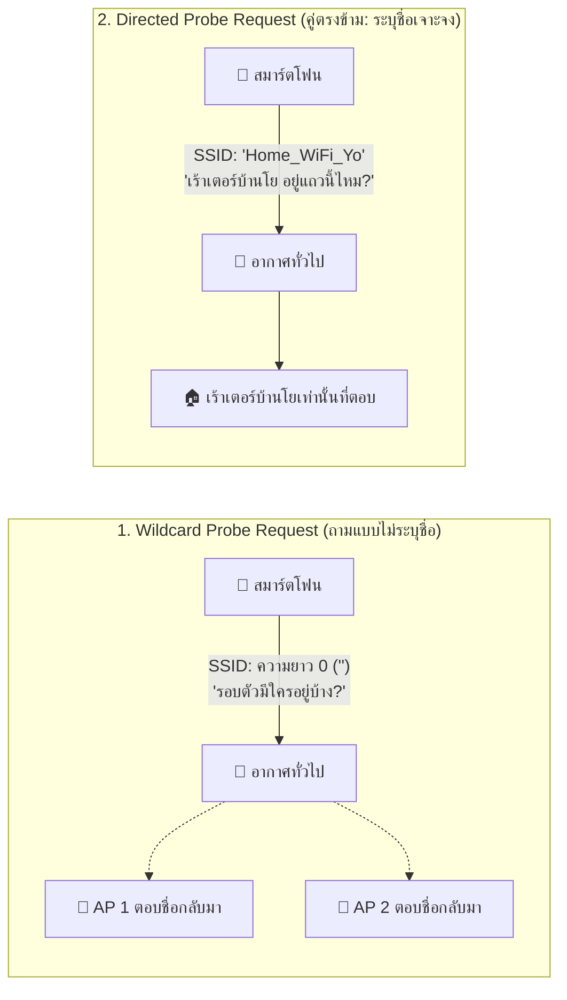
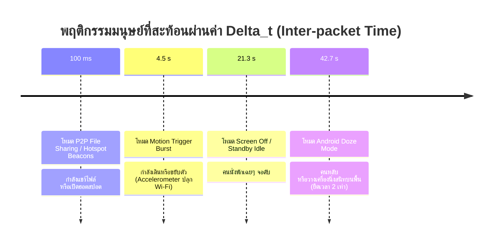
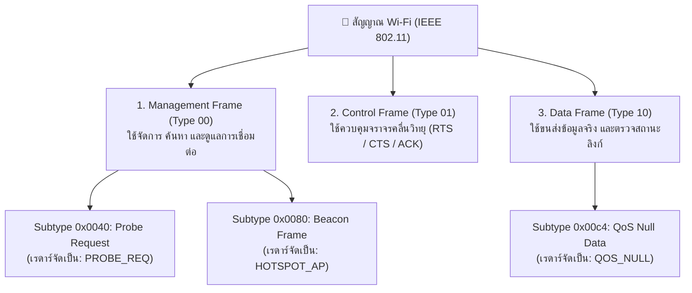

# 📘 คัมภีร์วิศวกรรม RF Sensing: ถอดรหัสพารามิเตอร์และระบบคลื่นวิทยุซ่อนเร้นในสมาร์ตโฟน
## (Master Study Guide: Smartphone RF Parameters, Hidden Protocols & Unconventional Systems)

<div align="center">


</div>

> [!IMPORTANT]
> **วัตถุประสงค์ของเอกสารนี้:**  
> เอกสารฉบับนี้จัดทำขึ้นเพื่อเป็น **"คู่มือการศึกษาภาคบังคับ (Must-Read Study Guide)"** สำหรับทีมวิจัย โดยรวบรวมและอธิบายความหมายของค่าตัวเลข พารามิเตอร์ในไฟล์บันทึก CSV ตลอดจนระบบโปรโตคอลวิทยุแปลกๆ ที่ไม่มีสอนในวิชาเครือข่ายคอมพิวเตอร์ทั่วไปในมหาวิทยาลัย เพื่อให้สามารถอ่านผลการทดลอง วิเคราะห์พฤติกรรมเป้าหมาย และนำไปตอบคำถามอาจารย์ที่ปรึกษาได้อย่างลึกซึ้งในระดับวิศวกรรมชั้นสูง

---

## 🧭 สารบัญเนื้อหา (Table of Contents)

1. [ความจริงทางกายภาพ: สิ่งที่ตำราเครือข่ายทั่วไปไม่ได้สอน](#1-ความจริงทางกายภาพ-สิ่งที่ตำราเครือข่ายทั่วไปไม่ได้สอน)
2. [พจนานุกรมค่าพารามิเตอร์ 4 กลุ่มหลักในไฟล์บันทึก (CSV Field Dictionary)](#2-พจนานุกรมค่าพารามิเตอร์-4-กลุ่มหลักในไฟล์บันทึก-csv-field-dictionary)
   * [กลุ่มที่ 1: มิติทางฟิสิกส์และความแรงคลื่น (RF Physics & Distance)](#กลุ่มที่-1-มิติทางฟิสิกส์และความแรงคลื่น-rf-physics--distance)
   * [กลุ่มที่ 2: มิติการระบุตัวตนและชิปเซ็ต (Identity & OUI Fingerprinting)](#กลุ่มที่-2-มิติการระบุตัวตนและชิปเซ็ต-identity--oui-fingerprinting)
   * [กลุ่มที่ 3: มิติกาลเวลาและพฤติกรรมมนุษย์ (Temporal & Human Dynamics)](#กลุ่มที่-3-มิติกาลเวลาและพฤติกรรมมนุษย์-temporal--human-dynamics)
   * [กลุ่มที่ 4: มิติประเภทเฟรมและทิศทางคลื่น (Frame & Protocol Type)](#กลุ่มที่-4-มิติประเภทเฟรมและทิศทางคลื่น-frame--protocol-type)
3. [ระบบและโปรโตคอลซ่อนเร้นที่ไม่ค่อยได้เจอในชีวิตประจำวัน](#3-ระบบและโปรโตคอลซ่อนเร้นที่ไม่ค่อยได้เจอในชีวิตประจำวัน)
   * [3.1 MTA Alliance (Mi Share / Quick Share Ecosystem)](#31-mta-alliance-mi-share--quick-share-ecosystem)
   * [3.2 กลไกคลื่นชีพจร QoS Null Data (The Phantom Heartbeat)](#32-กลไกคลื่นชีพจร-qos-null-data-the-phantom-heartbeat)
   * [3.3 การปราบ MAC Randomization ด้วย 12-bit Sequence Counter](#33-การปราบ-mac-randomization-ด้วย-12-bit-sequence-counter)
   * [3.4 ทำไม GPS และ 4G/5G ถึงใช้ค้นหาคนหลงป่าไม่ได้ด้วยบอร์ดตรวจจับ?](#34-ทำไม-gps-และ-4g5g-ถึงใช้ค้นหาคนหลงป่าไม่ได้ด้วยบอร์ดตรวจจับ)
   * [3.5 Wi-Fi Aware (Neighbor Awareness Networking - NAN): คลื่นสืบเสาะอัตโนมัติบน Channel 6](#35-wi-fi-aware-neighbor-awareness-networking---nan-คลื่นสืบเสาะอัตโนมัติบน-channel-6)
4. [คู่มือการแกะรหัสบันทึก CSV ภาคสนามจริง (Step-by-Step Log Decoding)](#4-คู่มือการแกะรหัสบันทึก-csv-ภาคสนามจริง-step-by-step-log-decoding)

---

## 1. ความจริงทางกายภาพ: สิ่งที่ตำราเครือข่ายทั่วไปไม่ได้สอน

ในวิชา Computer Networks มหาวิทยาลัยส่วนใหญ่สอนว่า:
> *"Wi-Fi ทำงานแบบ Client-Server โดยเครื่องลูกข่ายจะส่งข้อมูลเมื่อเชื่อมต่อกับเร้าเตอร์ (Access Point) ผ่าน 3-way handshake"*

**แต่ในโลกความจริงของสมาร์ตโฟนยุคใหม่:**
1. **มือถือไม่ใช่ผู้รับนิ่งๆ (Mobile Phones are Active Emitters):** แม้คุณจะเดินเข้าป่าที่ไม่มีสัญญาณเน็ต จอดับอยู่ในกระเป๋ากางเกง และไม่ได้ต่อ Wi-Fi แต่ **ชิปวิทยุภายในเครื่องยังคงยิงคลื่นวิทยุออกมาในอากาศตลอดเวลา** เพื่อกวาดหาโครงข่าย (Active Probing) และค้นหาอุปกรณ์ใกล้เคียง (BLE Discovery)
2. **ระบบตรวจจับแบบ Passive (Passive Sniffing):** เรดาร์ของเรา (Arduino Nano ESP32) ทำงานในโหมด **Promiscuous Mode** ซึ่งเปรียบเสมือนการ "กางหูฟังใบ้" ในอากาศ โดยตัวเราไม่ต้องส่งสัญญาณคลื่นวิทยุออกไปเลยแม้แต่วัตต์เดียว (แอบฟัง 100% ปลอดภัย ไม่เปลืองพลังงาน และไม่ถูกตรวจจับกลับ)

---

## 2. พจนานุกรมค่าพารามิเตอร์ 4 กลุ่มหลักในไฟล์บันทึก (CSV Field Dictionary)

### ⚙️ เจาะลึกรากฐาน: CSV คืออะไร และทำไมระบบสมองกลฝังตัว (ESP32) ถึงเลือกใช้?

* **CSV ย่อมาจากอะไร?**  
  **CSV** ย่อมาจาก **Comma-Separated Values** (แปลตรงตัว: *ข้อมูลหรือค่าตัวเลขที่คั่นด้วยเครื่องหมายจุลภาค `,`*)
* **โครงสร้างและรูปแบบ (Data Structure):**  
  เป็นรูปแบบไฟล์ข้อความธรรมดา (Plain Text) ตาราง 2 มิติ โดยแต่ละบรรทัดคือ **1 แถวข้อมูล (Record หรือ 1 แพ็กเก็ตที่จับได้)** และแต่ละคอลัมน์ข้อมูลจะถูกคั่นด้วยเครื่องหมาย `,` เช่น:
  ```text
  CSV,3886,5,11,-54,12,104,B8:B1:EA:DC:CD:D4,REAL,QOS_NULL,QOS_NULL,TO_DS,"Wildcard"
  ```
* **ทำไมงานวิศวกรรม RF เรดาร์บน ESP32 ถึงใช้ CSV แทน JSON หรือ Database?**
  1. **Zero RAM Overhead (ประหยัดหน่วยความจำระดับสูงสุด):** ชิปไมโครคอนโทรลเลอร์ ESP32-S3 มีหน่วยความจำ SRAM จำกัด (ประมาณ 512 KB) หากต้องสร้าง Data Object ในรูปแบบ JSON หรือ XML ชิปจะต้องจองบัฟเฟอร์หน่วยความจำขนาดใหญ่และเสี่ยงต่อปัญหาหน่วยความจำล้น (RAM Crash) ขณะที่ CSV สามารถส่งออกผ่าน `Serial.print(...)` ทีละคำโดยใช้แรมแทบเป็นศูนย์
  2. **High-Speed Real-time Streaming (ส่งข้อมูลสดทันที):** ในโหมด Promiscuous Mode บอร์ดอาจจับคลื่นได้หลายร้อยเฟรมต่อวินาที รูปแบบ CSV สตรีมออก Serial Port ทันทีโดยไม่มีความล่าช้า (Zero Processing Delay)
  3. **Direct Data Science Pipeline:** ไฟล์ CSV สามารถเปิดดูได้ทันทีบน Microsoft Excel หรือนำไปประมวลผลต่อด้วยภาษา Python ผ่านไลบรารี Pandas เพียงบรรทัดเดียว: `df = pd.read_csv("exp04_results.csv")`
* **ทำไมใน Log จริงมีคำว่า `CSV,` ขึ้นต้นทุกบรรทัด?**  
  ในระบบฝังตัว ตัวบอร์ดมักจะมีข้อความดีบักของระบบปะปนออกมาบน Serial Port ด้วย (เช่น `[INFO] Wi-Fi Promiscuous Init OK`) ดังนั้นการใส่คำว่า `CSV,` นำหน้าทุกแถวที่มีตัวเลขข้อมูล ทำหน้าที่เป็น **Stream Packet Identifier (Tag กรองข้อมูล)** เพื่อให้ซอฟต์แวร์ฝั่งคอมพิวเตอร์หรือแดชบอร์ดใช้คำสั่ง `if line.startswith("CSV,"):` ดึงเฉพาะแถวตัวเลขไปวิเคราะห์ โดยไม่เกิดข้อผิดพลาดจากข้อความดีบักทั่วไป

---

### กลุ่มที่ 1: มิติทางฟิสิกส์และความแรงคลื่น (RF Physics & Distance)

```
        เสาอากาศ ESP32 (RX)                               สมาร์ตโฟน (TX)
              ┌───┐                                           ┌───┐
              │📡 │ ◄ ~ ~ ~ ~ ~ ~ ~ ~ ~ ~ ~ ~ ~ ~ ~ ~ ~ ~ ~ │📱 │
              └───┘             ระยะทาง d (เมตร)               └───┘
       รับได้: RSSI (dBm)                              ส่งออก: Pt (dBm)
```

| ชื่อค่า / พารามิเตอร์ | หน่วย | ช่วงค่าปกติ | ความหมายและนิยามเชิงวิศวกรรม |
| :--- | :---: | :---: | :--- |
| **`rssi_dbm`** | dBm | `-30` ถึง `-95` | **Received Signal Strength Indicator:** ความแรงของกำลังคลื่นแม่เหล็กไฟฟ้าที่เสาอากาศรับได้ เป็นค่าลอการิทึมฐานสิบเทียบกับ 1 มิลลิวัตต์ (ค่าติดลบเสมอ) ยิ่งเข้าใกล้ 0 ยิ่งแรง เช่น `-40 dBm` (ใกล้มาก) ขณะที่ `-85 dBm` (ไกลหรือถูกใบไม้บัง) |
| **`channel`** | ช่อง | `1` ถึง `11` | **ช่องความถี่วิทยุ 2.4 GHz:** ความถี่กลางเริ่มต้นที่ 2,412 MHz (Ch 1) ถึง 2,462 MHz (Ch 11) แต่ละช่องห่างกัน 5 MHz โทรศัพท์จะสลับช่องยิง Probe Request หรือล็อกนิ่งอยู่ที่ช่องใดช่องหนึ่งเมื่อเปิด Hotspot (เช่น Ch 10) |
| **`PL_0` (Path Loss อ้างอิง)** | dBm | `-38.2` | กำลังงานที่เสาอากาศรับได้ที่ระยะอ้างอิง $d_0 = 1\text{ เมตร}$ ใช้เป็นจุดตั้งต้นในการคำนวณระยะทาง |
| **`n` (Path Loss Exponent)** | - | `2.0` ถึง `3.5` | สัมประสิทธิ์การลดทอนของคลื่นตามสภาพแวดล้อม (สูญญากาศ/ที่โล่งแจ้ง $n = 2.0$, ป่าโปร่ง $n \approx 2.45$, ป่าทึบ/สิ่งกีดขวาง $n \ge 3.0$) |
| **`Estimated Distance (d)`** | เมตร | `0.5` ถึง `50+` | ระยะห่างโดยประมาณระหว่างมือถือกับเรดาร์ คำนวณจากสูตร Log-Distance Path Loss: $$d = 10^{\frac{PL_0 - \text{RSSI}}{10 \times n}}$$ |

---

### กลุ่มที่ 2: มิติการระบุตัวตนและชิปเซ็ต (Identity & OUI Fingerprinting)

| ชื่อค่า / พารามิเตอร์ | รูปแบบข้อมูล | ความหมายและนิยามเชิงวิศวกรรม |
| :--- | :---: | :--- |
| **`mac`** | `XX:XX:XX:XX:XX:XX` | **Media Access Control Address:** รหัส 48 บิต (6 ไบต์) ประจำการ์ดเครือข่ายวิทยุ |
| **`mac_type`** | `REAL` / `RANDOM` | **ประเภทของ MAC Address:** ตรวจสอบจากบิตที่ 2 ของไบต์แรก (U/L Bit - Universal/Local Administered):<br>• **`REAL`:** รหัสแท้ที่บันทึกถาวรลงในชิปโรงงาน (Universal)<br>• **`RANDOM`:** รหัสชั่วคราวที่ระบบปฏิบัติการ Android/iOS สุ่มขึ้นมาเพื่อความปลอดภัย (Locally Administered) |
| **`vendor_id / OUI`** | Hex / ชื่อบริษัท | **Organizationally Unique Identifier:** รหัส 24 บิตแรก (3 ไบต์แรก) ของ MAC แท้ ที่จดทะเบียนกับ IEEE เพื่อระบุยี่ห้อผู้ผลิตชิป เช่น `B8:B1:EA` (Honor Device Co., Ltd.) หรือรหัส `0x038F` (Xiaomi Inc. ในฝั่งบลูทูธ) |
| **`service_uuid`** | 128-bit Hex | **GATT Service Universally Unique Identifier:** รหัสบริการของบลูทูธที่แอปพลิเคชันลงทะเบียนไว้ เช่น `00003331-0000-1000-8000-008123456789` คือโปรโตคอลแชร์ไฟล์ความเร็วสูงของกลุ่มพันธมิตร MTA Alliance |
| **`ssid`** | ข้อความ / `"Wildcard"` | **Service Set Identifier:** ชื่อของเครือข่าย Wi-Fi (ดูรายละเอียดคู่ตรงข้าม Wildcard vs Directed ด้านล่าง) |

#### ⚔️ เจาะลึกคู่ตรงข้าม: Wildcard SSID vs Directed SSID

ในการส่งสัญญาณ Probe Request ของสมาร์ตโฟน จะมีรูปแบบการถามหา Wi-Fi เพียง **2 ขั้วตรงข้ามกันอย่างสิ้นเชิง** ดังนี้:



| มิติการเปรียบเทียบ | 🌐 1. Wildcard SSID (Broadcast Probe) | 🎯 2. Directed SSID (คู่ตรงข้าม / Specific Probe) |
| :--- | :--- | :--- |
| **ความหมายและนิยาม** | **"ไม่เจาะจงชื่อ"** (Null/Wildcard) ความยาวชื่อ SSID เป็น 0 ไบต์ (`""`) | **"ระบุชื่อเป้าหมายเจาะจง"** มือถือเขียนชื่อ SSID ที่ต้องการหาลงไปในเฟรมตรงๆ |
| **คำถามที่ตะโกนในอากาศ** | *"แถวนี้มี Access Point หรือเร้าเตอร์ตัวไหนอยู่บ้าง ช่วยขานชื่อกลับมาที"* | *"เร้าเตอร์ชื่อ 'Home_WiFi_Yo' อยู่แถวนี้ไหม? ถ้าอยู่ช่วยตอบฉันด้วย"* |
| **พฤติกรรมในบันทึก CSV** | ปรากฏเป็นคำว่า **`"Wildcard"`** | ปรากฏเป็นชื่อจริง เช่น **`"Home_WiFi"`**, **`"Faculty_5G"`**, หรือชื่อ Hotspot **`"POCO X3 Pro"`** |
| **บริบทที่อุปกรณ์ส่งออกมา** | • เป็นพฤติกรรมมาตรฐาน (Default) ของ Android 10+ และ iOS 14+<br>• ส่งเพื่อค้นหา AP ทั่วไปโดยไม่เปิดเผยตัวตน | • **ค้นหา Hidden SSID (Wi-Fi ซ่อนชื่อ):** เร้าเตอร์ซ่อนชื่อจะไม่ประกาศตัว มือถือจึงจำใจต้องตะโกนเรียกชื่อตรงๆ<br>• **Preferred Network List (PNL):** สมาร์ตโฟนรุ่นเก่า/อุปกรณ์ที่พยายามเชื่อมต่อเน็ตเดิมที่คุ้นเคย<br>• **เมื่อผู้ใช้เปิด Mobile Hotspot:** เครื่องจะประกาศชื่อ Hotspot จริงออกมาเป็น Beacon |
| **ความปลอดภัยและความเป็นส่วนตัว (Privacy)** | **ปลอดภัยสูงสุด:** คนดักฟังจะไม่รู้ว่าผู้ใช้เคยไปที่ไหนหรือมีประวัติเชื่อมต่อ Wi-Fi ใดมาก่อน | **อันตรายอย่างยิ่ง (PNL Leakage):** คนดักฟังสามารถทำ Profile สืบได้ทันทีว่าเจ้าของเครื่องพักที่ไหน ทำงานที่ไหน เสี่ยงต่อการถูกโจมตีด้วย Evil Twin Attack |


---

### กลุ่มที่ 3: มิติกาลเวลาและพฤติกรรมมนุษย์ (Temporal & Human Dynamics)

| ชื่อค่า / พารามิเตอร์ | หน่วย | ความหมายและพฤติกรรมทางกายภาพ |
| :--- | :---: | :--- |
| **`timestamp_ms`** | ms | เวลาการทำงานของบอร์ดไมโครคอนโทรลเลอร์นับตั้งแต่บูตเครื่อง (1,000 ms = 1 วินาที) |
| **`delta_t_ms` ($\Delta t$)** | ms | **Inter-packet Arrival Time:** ช่วงเวลาห่างระหว่างแพ็กเก็ตที่จับได้จากอุปกรณ์เดิม ค่านี้บ่งบอกพฤติกรรมของคนพกมือถือได้อย่างน่าทึ่ง: |



---

### กลุ่มที่ 4: มิติประเภทเฟรมและทิศทางคลื่น (Frame & Protocol Type)

| ชื่อค่า / พารามิเตอร์ | ค่าตัวอย่าง | ความหมายเชิงเทคนิค |
| :--- | :---: | :--- |
| **`seq_num`** | `0` ถึง `4095` | **Sequence Control Number (12 บิต):** ตัวนับลำดับแพ็กเก็ตที่ฝังอยู่ในฮาร์ดแวร์ชิปวิทยุ วิ่งวนรอบแบบ Modulo 4096 ($0 \rightarrow 4095 \rightarrow 0$) **นี่คือคีย์ลัดที่ใช้ปราบ MAC Randomization!** แม้มือถือจะสุ่ม MAC เปลี่ยนไปเรื่อยๆ แต่เลข Sequence จะวิ่งเรียงต่อเนื่องกันเสมอ ($102 \rightarrow 103 \rightarrow 104$) |
| **`category`** | `PROBE_REQ`, `HOTSPOT_AP`, `QOS_NULL` | หมวดหมู่การใช้งานของคลื่นที่ตรวจจับได้ (ดูรายละเอียดสถาปัตยกรรม Category ด้านล่าง) |
| **`subtype`** | `0x0040`, `0x0080`, `0x00c4` | รหัส Subtype ของ IEEE 802.11 Frame Header: <br>• `0x0040` (Probe Request): ค้นหาเร้าเตอร์<br>• `0x0080` (Beacon Frame): คลื่นกระจายสัญญาณของฮอตสปอต<br>• `0x00c4` (QoS Null Data): คลื่นชีพจรเช็คสถานะการเชื่อมต่อ |
| **`link_dir`** | `TO_DS` / `DIRECT` | **Link Direction:** <br>• `TO_DS` (To Distribution System): คลื่นที่ **ส่งออกจากมือถือมุ่งหน้าไปหาเร้าเตอร์** (ยืนยัน 100% ว่าอุปกรณ์ส่งคือมือถือ ไม่ใช่เสาเร้าเตอร์)<br>• `DIRECT`: คลื่นที่ยิงกระจายออกอากาศแบบอิสระรอบทิศทาง |

#### 📡 ผ่าโครงสร้าง Category: สัญญาณ Wi-Fi อยู่ในหมวดหมู่ไหน และแบ่งประเภทอย่างไร?

เมื่อพูดถึงคำว่า **"สัญญาณ Wi-Fi"** ในเชิงวิศวกรรมเครือข่าย จะถูกแบ่งออกเป็น **2 ระดับ Category** ที่ต้องเข้าใจให้แม่นยำ:



##### 1. หมวดหมู่ระดับสากล: IEEE 802.11 Frame Architecture (3 Major Categories)
มาตรฐานโลก IEEE 802.11 แบ่งประเภทของเฟรมคลื่นวิทยุที่ลอยอยู่ในอากาศออกเป็น **3 หมวดหมู่หลัก (Major Types)**:
1. **Management Frames (Type `00` - เฟรมจัดการเครือข่าย):**
   * ทำหน้าที่สร้าง เชื่อมต่อ เจรจา และตัดความสัมพันธ์ระหว่างเครื่องลูกข่ายกับเร้าเตอร์
   * ตัวอย่างสำคัญ:
     * `Probe Request (0x0040)`: มือถือร้องถามหาเครือข่ายรอบตัว
     * `Beacon Frame (0x0080)`: เร้าเตอร์หรือฮอตสปอตตะโกนบอกตัวตนในอากาศ
     * `Association Request/Response (0x0000 / 0x0020)`: กระบวนการขอจับคู่เข้าสู่เครือข่าย
     * `Authentication / Deauthentication (0x00b0 / 0x00c0)`: การยืนยันตัวตนและตัดการเชื่อมต่อ
2. **Control Frames (Type `01` - เฟรมควบคุมจราจรคลื่น):**
   * ทำหน้าที่เป็น "ตำรวจจราจรทางอากาศ" คอยควบคุมไม่ให้คลื่นของแต่ละอุปกรณ์ชนกัน (Collision Avoidance) ไม่มีข้อมูล payload ของผู้ใช้
   * ตัวอย่างสำคัญ: `RTS` (Request to Send), `CTS` (Clear to Send), `ACK` (Acknowledgement ยืนยันการรับแพ็กเก็ต)
3. **Data Frames (Type `10` - เฟรมข้อมูลและสถานะ):**
   * ทำหน้าที่ขนส่งข้อมูลอินเทอร์เน็ตจริง (IP Packets, รูปภาพ, ข้อความแชท)
   * รวมถึงเฟรมพิเศษชนิดที่ไม่มีข้อมูลผู้ใช้ แต่ใช้ส่งสัญญาณชีพจรเพื่อรักษาช่องสัญญาณและแจ้งสถานะประหยัดพลังงาน ได้แก่ **`QoS Null Data (0x00c4)`**

##### 2. หมวดหมู่ระดับเรดาร์ตรวจจับ: Tactical Radar Categories (3 ค่ายที่เราดักจับ)
ในเฟิร์มแวร์เรดาร์ ESP32 เรานำคลื่นที่ลอยในอากาศมากรองและจัดเป็น 3 กลุ่มพฤติกรรมในคอลัมน์ `category`:
1. **`PROBE_REQ` (อยู่ใน 802.11 Management):** มือถืออยู่ในสถานะค้นหาเครือข่าย (หน้าจอดับหรือเดินไปมา) ยิงออกมาถามหาเร้าเตอร์ลอยๆ
2. **`HOTSPOT_AP` (อยู่ใน 802.11 Management):** มือถือถูกเปิดโหมด Tethering/Personal Hotspot ยิง Beacon สม่ำเสมอทุกๆ 100 ms
3. **`QOS_NULL` (อยู่ใน 802.11 Data):** มือถือเชื่อมต่อกับ Wi-Fi อยู่ และกำลังยิงคลื่นชีพจร Keep-Alive ไปยัง AP อย่างต่อเนื่อง เผยให้เห็น Real Hardware MAC เสมอ!

---

## 3. ระบบและโปรโตคอลซ่อนเร้นที่ไม่ค่อยได้เจอในชีวิตประจำวัน

ในชีวิตประจำวัน คนทั่วไปคิดว่ามือถือส่งแค่เน็ต 4G/5G หรือเล่น Wi-Fi ธรรมดา แต่ในงานวิจัยนี้ เราได้เจาะลึกระบบที่ทำงานอยู่เบื้องหลังระบบปฏิบัติการ:

### 3.1 MTA Alliance (Mi Share / Quick Share Ecosystem)
* **มันคืออะไร?**  
  **MTA (Mutual Transmission Alliance)** คือกลุ่มพันธมิตรผู้ผลิตสมาร์ตโฟนยักษ์ใหญ่ของโลก (ก่อตั้งโดย Xiaomi, OPPO, Vivo, และร่วมด้วย Realme, OnePlus, ASUS, Black Shark) เพื่อสร้างมาตรฐานการส่งไฟล์ข้ามยี่ห้อได้โดยตรงแบบไม่ต้องพึ่งพาอินเทอร์เน็ต
* **เบื้องหลังการทำงาน:**
  1. เมื่อผู้ใช้เปิดปุ่ม **Mi Share** หรือ **Quick Share** บนแถบเมนูด้านบนของมือถือ
  2. โทรศัพท์จะเปิดบลูทูธพลังงานต่ำ (**BLE Advertising**) ยิงแพ็กเก็ตสืบเสาะออกมาทุกๆ **$100\text{ ms}$** อย่างต่อเนื่อง
  3. ภายในแพ็กเก็ตจะมีรหัส **Vendor Specific Data (Type `0xFF`)** พร้อมระบุ **Manufacturer ID `0x038F` (Xiaomi Inc.)** และ **Service UUID `00003331`**
* **ประโยชน์ในภารกิจค้นหา:**  
  หากคนหลงป่าพยายามเปิดส่งรูปหรือแชร์ตำแหน่งให้อีกเครื่องหนึ่ง คลื่น BLE นี้จะยิงรัวถึง **8 แพ็กเก็ตต่อวินาที** ทำให้เรดาร์ ESP32 ล็อกเป้าหมายได้อย่างแม่นยำในระยะ 15–25 เมตรทันที!

---

### 3.2 กลไกคลื่นชีพจร QoS Null Data (The Phantom Heartbeat)
* **ปกติในตำรา:** จะสอนแต่ "Data Frame" ที่ใช้ส่งข้อมูลหน้าเว็บหรือรูปภาพ
* **สิ่งที่เกิดขึ้นจริง:**  
  เมื่อมือถือเชื่อมต่อกับ Wi-Fi อยู่ แต่ไม่มีการเปิดแอปใดๆ (เช่น หน้าจอดับ) ระบบปฏิบัติการ Android/iOS จำเป็นต้องส่งเฟรมชนิดพิเศษที่ชื่อว่า **QoS Null Data (Subtype `0x00c4`)** ออกไปหาเร้าเตอร์ทุกๆ 10–500 ms
* **ทำไมมือถือต้องส่ง?**
  1. เพื่อแจ้งเร้าเตอร์ว่า *"ฉันยังมีชีวิตอยู่ อย่าเพิ่งตัดฉันออกจากระบบ (Keep-Alive)"*
  2. เพื่อส่งบิต Power Management แจ้งว่าการ์ด Wi-Fi จะขอนอนหลับสั้นๆ (Sleep) ให้เร้าเตอร์ช่วยจำข้อมูลไว้ก่อน
* **จุดอ่อนที่กลายเป็นข้อได้เปรียบของเรา:**  
  เฟรม QoS Null Data นี้ **เป็นเฟรมระดับ Data Link ไม่ใช่ Management Frame** ระบบปฏิบัติการจึง **ไม่สามารถสุ่ม MAC Address ได้! มันจำใจต้องส่ง Hardware MAC จริงจากโรงงานออกมาเสมอ** ทำให้เราดักจับได้และรู้ยี่ห้อเครื่องทันที (เช่น `B8:B1:EA` ของ Honor)!

---

### 3.3 การปราบ MAC Randomization ด้วย 12-bit Sequence Counter
* **เทคโนโลยี MAC Randomization คืออะไร?**  
  ตั้งแต่ Android 10 และ iOS 14 เป็นต้นมา เพื่อป้องกันการถูกสะกดรอยตามในห้างหรือที่สาธารณะ ระบบจะทำการ **สุ่มเปลี่ยน MAC Address ใหม่ทุกครั้งที่ยิง Probe Request หรือเปลี่ยนทุกๆ ไม่กี่นาที** ทำให้คนที่ดักฟังคิดว่าเป็นเครื่องใหม่ตลอดเวลา
* **ช่องโหว่ทางวิศวกรรมฮาร์ดแวร์ (Hardware-level Sequence Leakage):**
  * ถึงแม้ฝ่ายซอฟต์แวร์ (OS) จะสุ่ม MAC Address ได้อย่างชาญฉลาด แต่ในระดับกายภาพ **วงจรนับแพ็กเก็ต (Sequence Counter) เป็นวงจรฮาร์ดแวร์ระดับซิลิคอนในการ์ดวิทยุ** ซึ่งจะนับเลขเพิ่มทีละ 1 เสมอทุกครั้งที่ส่งคลื่น
  * **หลักการปราบของเรดาร์เรา:**  
    สมมุติเวลา 10:00:00 จับ MAC `66:CE:4C...` ได้ Sequence = `12`  
    เวลา 10:00:01 มี MAC ใหม่โผล่มาเป็น `D6:BE:63...` แต่มี Sequence = `13` และต่อด้วย `14`  
    ระบบของเราจะรู้ทันทีว่า **"นี่ไม่ใช่ 2 เครื่อง แต่คือเครื่องเดิมที่เพิ่งสุ่มเปลี่ยนหน้ากาก MAC Address!"**

---

### 3.4 ทำไม GPS และ 4G/5G ถึงใช้ค้นหาคนหลงป่าไม่ได้ด้วยบอร์ดตรวจจับ?

```mermaid
flowchart TD
    subgraph GPS_Reality["🛰️ ความจริงของระบบ GPS (Passive Downlink Only)"]
        G1["ดาวเทียม GPS 20,000 กม. ในอวกาศ"] -->|"ยิงคลื่น 1.575 GHz ลงมา"| G2["📱 มือถือคนหลงป่า (กางหูฟังฝ่ายเดียว)"]
        G2 -.->|"❌ ไม่มียื่นคลื่นส่งกลับขึ้นไป"| G1
        G2 -.->|"❌ ไม่มีคลื่นแผ่ออกมาในป่า"| G3["เรดาร์ภาคพื้นดิน (จับอะไรไม่ได้เลย)"]
    end

    subgraph Cellular_Reality["📡 ความจริงของ 4G/5G ในป่าลึก (Network-Driven Backoff)"]
        C1["เสาสัญญาณมือถือ (eNodeB)"] -.->|"❌ สัญญาณส่งไม่ถึง (ป่าทึบบังมิด)"| C2["📱 มือถือคนหลงป่า"]
        C2 -->|"เมื่อไม่ได้ยินเสาแม่ มือถือจะหยุดส่งคลื่นเพื่อเซฟแบต"| C3["💤 Sleep / Silent Mode (ไม่ยิงคลื่น)"]
    end
```



1. **GPS:** มือถือทำตัวเหมือน **"เรือที่มองดูประภาคาร"** ดาวเทียมยิงแสงลงมา มือถือคำนวณตำแหน่งดูคนเดียวเงียบๆ **ไม่มีคลื่น GPS หลุดออกมาจากมือถือแม้แต่วัตต์เดียว**
2. **4G/5G:** ระบบเซลลูลาร์ควบคุมด้วยเสาแม่ (Network-Driven) ถ้ามือถือไม่ได้ยินสัญญาณประกาศ (MIB/SIB) จากเสาแม่ **มันจะไม่ยิงคลื่นสุ่มสี่สุ่มห้าออกมาเด็ดขาด** ต่างจาก Wi-Fi Probe Request ที่มือถือจะตะโกนหาเร้าเตอร์ในป่าตลอดเวลา!

---

### 3.5 Wi-Fi Aware (Neighbor Awareness Networking - NAN): คลื่นสืบเสาะอัตโนมัติบน Channel 6

* **Wi-Fi Aware คืออะไร?**  
  **Wi-Fi Aware** (หรือชื่อทางเทคนิคตามมาตรฐาน Wi-Fi Alliance คือ **NAN - Neighbor Awareness Networking** อิงมาตรฐาน IEEE 802.11aq) คือเทคโนโลยีเครือข่ายไร้สายยุคใหม่ที่ถูกฝังมาใน **Android 8.0 (API Level 26) ขึ้นไป** เพื่อให้อุปกรณ์รอบตัวสามารถ **"มองเห็นและค้นพบซึ่งกันและกันได้โดยตรงแบบ Peer-to-Peer โดยไม่ต้องมีอินเทอร์เน็ต และไม่ต้องเชื่อมต่อกับ Access Point (เร้าเตอร์) เลยแม้แต่น้อย!"**

* **เบื้องหลังการทำงานทางกายภาพ (Physical & Protocol Mechanics):**
  1. **สืบเสาะแบบ Cluster อัตโนมัติ:** เมื่อสมาร์ตโฟนเปิดใช้งานบริการที่มี Wi-Fi Aware (เช่น Quick Share, Nearby Share, Google Nearby Messages หรือแอปแชร์พิกัด) ชิปวิทยุ Wi-Fi จะทำการรวมกลุ่มกันเป็น Cluster ในระดับต่ำ
  2. **ล็อกช่องความถี่ตายตัวที่ Channel 6 (2,437 MHz):**  
     ในย่านความถี่ 2.4 GHz มาตรฐานกำหนดให้ Wi-Fi Aware ส่งคลื่นสืบเสาะเฉพาะบน **Channel 6 เท่านั้น!** (บน 5 GHz ใช้ Channel 149)
  3. **หน้าต่างค้นหา Discovery Window (DW):**  
     อุปกรณ์ที่อยู่ในข่ายจะตื่นขึ้นมาพร้อมกันทุกๆ **512 Time Units (ประมาณ 524.28 มิลลิวินาที หรือราวครึ่งวินาที)** เพื่อยิงเฟรมชนิดพิเศษที่เรียกว่า:
     * **NAN Sync Beacon (เฟรมซิงก์เวลา)**
     * **NAN Service Discovery Frame (SDF - Action Frame ชนิด Public Action)**

* **Wi-Fi Aware เกี่ยวข้องกับโปรเจกต์เรดาร์ตรวจจับของเราอย่างไร?**
  > **คำตอบสั้น:** **"เกี่ยวข้องกันอย่างยิ่ง (Extremely Relevant) และเป็นเหมืองทองคำแห่งที่สองต่อจาก Probe Request!"**

  1. **เป็นแหล่งกำเนิดคลื่นอิสระในป่าลึก (Zero-Infrastructure RF Emitter):**  
     แม้คนหลงป่าจะปิดการต่อ Wi-Fi ทั่วไป แต่หากระบบปฏิบัติการเปิดฟีเจอร์ Quick Share / Nearby Sharing ทิ้งไว้ เครื่องจะยิงเฟรม Wi-Fi Aware ออกมาเป็นจังหวะในอากาศเองโดยอัตโนมัติ
  2. **ลดภาระการกวาดช่องสัญญาณ (Channel Lock Advantage):**  
     ปกติเรดาร์เราต้องวนสแกน Channel 1 ถึง 11 (ใช้เวลา 1.1 วินาที) แต่สำหรับ Wi-Fi Aware **คลื่นจะยิงมาที่ Channel 6 เสมอ!** ทำให้ในภารกิจเฝ้าระวัง เราสามารถล็อกหูฟัง ESP32 ไว้ที่ช่อง 6 เป็นพิเศษเพื่อดักจับสัญญาณประเภทนี้ได้ทันที
  3. **ESP32 ดักฟังได้หรือไม่? (Promiscuous Mode Capability):**  
     * **ในฐานะเครื่องรับส่งปกติ:** ชิป ESP32 *ไม่สามารถเข้าร่วมเป็นสมาชิกใน NAN Cluster ได้* เนื่องจาก Stack ซอฟต์แวร์ของ ESP-IDF ไม่มี NAN Protocol Parser
     * **ในฐานะเรดาร์ดักฟังใบ้ (Passive Sniffer):** **"ทำได้ 100%!"** เพราะในโหมด Promiscuous Mode บอร์ด ESP32 ไม่สนใจว่าข้อมูลข้างในคืออะไร มันแค่ดักจับทุกแพ็กเก็ตที่ลอยใน Channel 6 ซึ่งเฟรม NAN ก็คือ IEEE 802.11 Management / Action Frame ธรรมดา บอร์ดจึงสามารถดึง **ค่า RSSI (วัดระยะทาง), MAC Address (ทั้งแท้และสุ่ม), Sequence Number (แกะรอย), และเวลา $\Delta t$** ออกมาบันทึกใน CSV ได้ครบถ้วน!

---

## 4. คู่มือการแกะรหัสบันทึก CSV ภาคสนามจริง (Step-by-Step Log Decoding)

ตัวอย่างแถวข้อมูลจริงจากไฟล์ [`exp04_omni_wifi_results.csv`](file:///d:/ProjectCo-op/share_friend/Experiments/yo_experiments/Raw_Logs/exp04_omni_wifi_results.csv):

```csv
CSV,3886,5,11,-54,12,104,B8:B1:EA:DC:CD:D4,REAL,QOS_NULL,QOS_NULL,TO_DS,"Wildcard"
```

### 🔍 ถอดรหัสทีละช่องข้อมูล:
1. **`CSV`** : ย่อมาจาก **Comma-Separated Values** (ค่าที่คั่นด้วยจุลภาค) ในบรรทัดนี้ทำหน้าที่เป็น **Stream Packet Identifier (Prefix Tag)** เพื่อให้ซอฟต์แวร์แดชบอร์ด/สคริปต์กรองดึงเฉพาะแถวข้อมูลตัวเลขออกจากข้อความดีบักทั่วไปได้อย่างแม่นยำ
2. **`3886`** : เวลาการทำงานนับตั้งแต่เปิดบอร์ด คือ **3,886 มิลลิวินาที (ประมาณ 3.8 วินาที)**
3. **`5`** : แพ็กเก็ตที่ 5 ที่ดักจับได้ในเซสชันนี้
4. **`11`** : คลื่นนี้วิ่งมาบน **Wi-Fi Channel 11 (2,462 MHz)**
5. **`-54`** : ความแรงสัญญาณ **`-54 dBm`** (แรงมาก บ่งบอกว่ามือถืออยู่ห่างจากบอร์ดเรดาร์เพียง **4–6 เมตร**)
6. **`12`** : $\Delta t = 12\text{ ms}$ (ยิงห่างจากแพ็กเก็ตก่อนหน้าเพียง 0.012 วินาที เป็นความถี่ระดับชีพจร)
7. **`104`** : **Sequence Number = 104** (ชิปกำลังส่งต่อเนื่องจากเลข 103)
8. **`B8:B1:EA:DC:CD:D4`** : MAC Address ของอุปกรณ์ส่ง
9. **`REAL`** : ยืนยันว่า **นี่คือ Hardware MAC จริงจากโรงงาน** (ไม่ได้สุ่ม!)
10. **`QOS_NULL, QOS_NULL`** : ประเภทของเฟรมคือ คลื่นชีพจรเช็คสถานะการต่อเน็ต (จัดอยู่ในกลุ่ม Data Frame Subtype `0x00c4`)
11. **`TO_DS`** : ทิศทางคลื่นคือ **ส่งตรงจากโทรศัพท์ไปหาเร้าเตอร์**
12. **`"Wildcard"`** : ความยาวชื่อ SSID เป็น 0 (Null SSID / Broadcast Probe) ไม่ระบุชื่อเครือข่ายเพื่อปกป้องความเป็นส่วนตัว (ตรงข้ามกับ **Directed SSID** ที่จะระบุชื่อเครือข่ายจริงออกมา)

---

### 🏆 บทสรุปภาพรวมสำหรับนักวิจัย
เมื่ออ่านคู่มือนี้จบ โยและทีมงานจะเห็นภาพชัดเจนว่า **ตัวเลขทุกตัวในไฟล์ CSV มีชีวิตและมีความหมายทางกายภาพซ่อนอยู่ทั้งหมด** ข้อมูลเหล่านี้คือวัตถุดิบชั้นยอดที่ทำให้เรดาร์ ESP32 สามารถคำนวณระยะทาง คัดแยกยี่ห้อชิปเซ็ต ปราบการสุ่ม MAC และชี้พิกัดของคนหลงป่าได้อย่างแม่นยำในภารกิจจริงครับ!

