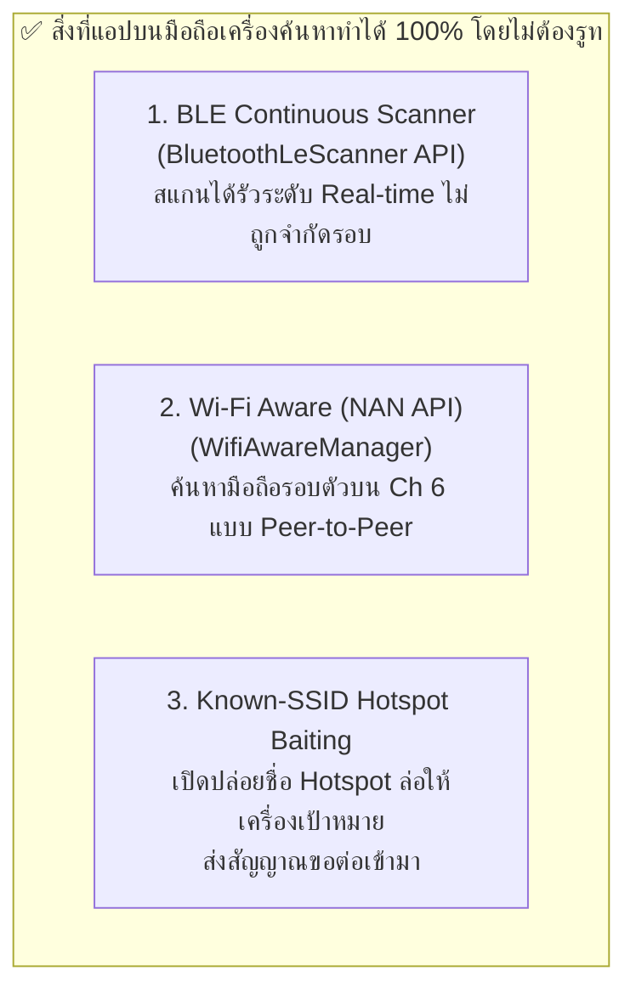
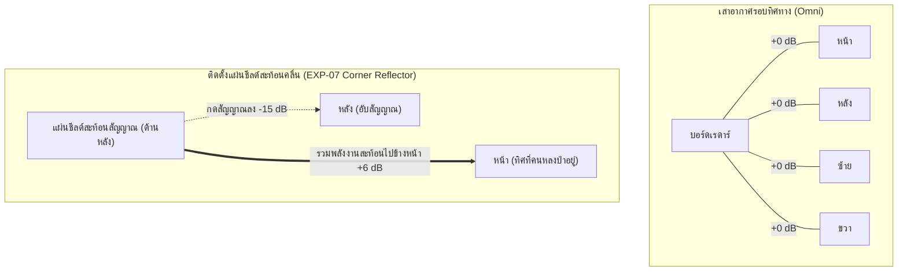

# 📱 เอกสารวิจัยฉบับที่ 11: การวิเคราะห์ความเป็นไปได้เชิงวิศวกรรมในการค้นหาระหว่างสมาร์ตโฟน
## (Feasibility Study: Native Phone-to-Phone Smartphone Search vs. Smart Dongle Architecture)

<div align="center">


</div>

> [!IMPORTANT]
> **ที่มาและวัตถุประสงค์ของเอกสารนี้:**  
> ในการนำไปใช้งานจริงในสนามกู้ภัย เจ้าหน้าที่หรือผู้ใช้งานย่อมต้องการ **"ใช้สมาร์ตโฟนเพียงเครื่องเดียวในการเดินค้นหาอีกเครื่องหนึ่ง"** โดยไม่ต้องพกพาคอมพิวเตอร์โน้ตบุ๊ก เอกสารฉบับนี้จัดทำขึ้นเพื่อ **วิเคราะห์ความเป็นไปได้ทางวิศวกรรมอย่างลึกซึ้ง** โดยผ่าโครงสร้างระบบปฏิบัติการ Android / iOS เปรียบเทียบข้อจำกัดทางกฎหมายและความปลอดภัย และนำเสนอสถาปัตยกรรมทางออกที่ตอบโจทย์ทั้งการใช้งานจริงและเกณฑ์วิชาการ

---

## 🧭 สารบัญเนื้อหา (Table of Contents)

1. [โจทย์ทางวิศวกรรมและข้อจำกัดของระบบปฏิบัติการมือถือ](#1-โจทย์ทางวิศวกรรมและข้อจำกัดของระบบปฏิบัติการมือถือ)
2. [การผ่าระบบปฏิบัติการ: ทำไมมือถือทั่วไปถึง "หูหนวก" ต่อ Wi-Fi Probe Request ของเพื่อน?](#2-การผ่าระบบปฏิบัติการ-ทำไมมือถือทั่วไปถึง-หูหนวก-ต่อ-wi-fi-probe-request-ของเพื่อน)
3. [สิ่งที่มือถือสามารถทำได้จริงแบบ Native 100% (ไม่ต้องรูทเครื่อง)](#3-สิ่งที่มือถือสามารถทำได้จริงแบบ-native-100-ไม่ต้องรูทเครื่อง)
   * [3.1 BLE Continuous Scanner (ขุมทรัพย์บลูทูธพลังงานต่ำ)](#31-ble-continuous-scanner-ขุมทรัพย์บลูทูธพลังงานต่ำ)
   * [3.2 Wi-Fi Aware (NAN Framework บน Android 8+)](#32-wi-fi-aware-nan-framework-บน-android-8)
   * [3.3 กลยุทธ์ Known-SSID Hotspot Baiting (การเปิดฮอตสปอตล่อ)](#33-กลยุทธ์-known-ssid-hotspot-baiting-การเปิดฮอตสปอตล่อ)
4. [การวิเคราะห์สถาปัตยกรรมแบบ Rooted / Custom Kernel (Nexmon / NetHunter)](#4-การวิเคราะห์สถาปัตยกรรมแบบ-rooted--custom-kernel-nexmon--nethunter)
5. [สถาปัตยกรรมที่ลงตัวที่สุดในโลกความจริง: "Smartphone + USB-C Smart Dongle" (FLIR One Paradigm)](#5-สถาปัตยกรรมที่ลงตัวที่สุดในโลกความจริง-smartphone--usb-c-smart-dongle-flir-one-paradigm)
6. [EXP-07: การบีบมุมเพื่อหาทิศทางเป้าหมาย (Directional RF Seeking)](#6-exp-07-การบีบมุมเพื่อหาทิศทางเป้าหมาย-directional-rf-seeking)
7. [ตารางเปรียบเทียบเชิงวิศวกรรมและการตัดสินใจ (Decision Matrix)](#7-ตารางเปรียบเทียบเชิงวิศวกรรมและการตัดสินใจ-decision-matrix)

---

## 1. โจทย์ทางวิศวกรรมและข้อจำกัดของระบบปฏิบัติการมือถือ

ในสถานการณ์ค้นหาคนหลงป่าหรือผู้ประสบภัย:
* **เครื่องเป้าหมาย (Target Phone):** เป็นสมาร์ตโฟนทั่วไป (Android / iOS) ของคนหลงป่า อยู่ในสถานะ **Zero-App** (ไม่มีแอปเฉพาะทาง, ไม่มีสัญญาณอินเทอร์เน็ต, ไม่มีซิมเซลลูลาร์, จอดับอยู่ในกระเป๋า)
* **เครื่องค้นหา (Searcher Device):** เจ้าหน้าที่กู้ภัยต้องการถืออุปกรณ์ขนาดพกพาที่คล่องตัวที่สุด ซึ่งก็คือ **"สมาร์ตโฟนของเจ้าหน้าที่"**


คำถามสำคัญคือ: **"เราสามารถเขียนแอปบนมือถือเครื่องค้นหา เพื่อดักจับคลื่นจากมือถือคนหลงป่าโดยตรงได้เลยหรือไม่?"**

---

## 2. การผ่าระบบปฏิบัติการ: ทำไมมือถือทั่วไปถึง "หูหนวก" ต่อ Wi-Fi Probe Request ของเพื่อน?

ในการทดลอง **EXP-04** เราพิสูจน์แล้วว่าชิป ESP32 สามารถดักฟัง Wi-Fi Probe Request ในอากาศได้อย่างง่ายดาย แต่เมื่อนำโจทย์นี้มาเขียนแอปบนสมาร์ตโฟน (Android / iOS) ทั่วไป จะพบกับกำแพงความปลอดภัยระดับเคอร์เนล:

```
┌────────────────────────────────────────────────────────────────────────┐
│                   📱 สถาปัตยกรรมซอฟต์แวร์ของ Android Wi-Fi Stack        │
├────────────────────────────────────────────────────────────────────────┤
│  [User Space App]  แอปเรดาร์กู้ภัย (เรียกใช้ WifiManager.startScan())     │
│        ▲                                                               │
│        │ ❌ ระบบ OS กรองทิ้ง! ส่งคืนเฉพาะรายชื่อ Access Point (เราเตอร์)    │
│  [Android Framework]  Wi-Fi Service (บังคับกฎความปลอดภัยและ Scan Throttling)  │
│        ▲                                                               │
│        │ ❌ ไม่อนุญาตให้เปิด Monitor Mode (ต้องใช้ Root สิทธิ์สูงสุด)     │
│  [Linux Kernel]     cfg80211 / mac80211 Layer                          │
│        ▲                                                               │
│  [Wi-Fi Chipset]    Broadcom / Qualcomm / MediaTek Driver              │
└────────────────────────────────────────────────────────────────────────┘
```

### สาเหตุเชิงวิศวกรรม 3 ประการ:
1. **การปิดกั้น Promiscuous / Monitor Mode ในระดับเคอร์เนล:**  
   ระบบปฏิบัติการ Android มาตรฐานและ iOS ไม่อนุญาตให้แอปพลิเคชันเปิดโหมด Monitor Mode หรือเข้าถึง Raw 802.11 Frame เพื่อป้องกันไม่ให้แอปดักขโมยข้อมูลของคนอื่นในร้านกาแฟหรือที่สาธารณะ
2. **`WifiManager.startScan()` กรองทิ้งเฉพาะ AP:**  
   คำสั่งสแกน Wi-Fi ของ Android ได้รับการออกแบบมาเพื่อค้นหาเราเตอร์เท่านั้น ชิปไดรเวอร์จะส่งเฉพาะเฟรม **Beacon** และ **Probe Response** จาก Access Point ขึ้นมาให้แอป แต่ **เฟรม Probe Request ที่มือถือของคนหลงป่ายิงออกมา จะถูกตัดทิ้งในระดับฮาร์ดแวร์/ไดรเวอร์ทันที!**
3. **การจำกัดความถี่ในการสแกน (Wi-Fi Scan Throttling):**  
   ตั้งแต่ Android 9 (Pie) เป็นต้นมา เพื่อประหยัดพลังงาน ระบบจำกัดให้แอปที่เปิดอยู่บนหน้าจอ (Foreground App) สแกน Wi-Fi ได้เพียง **4 ครั้ง ต่อ 2 นาที** (เฉลี่ย 30 วินาทีต่อครั้ง) ซึ่งช้าเกินกว่าจะทำเป็นหน้าจอเรดาร์แสดงผลสด (Real-time Radar) ได้

---

## 3. สิ่งที่มือถือสามารถทำได้จริงแบบ Native 100% (ไม่ต้องรูทเครื่อง)

แม้ระบบปฏิบัติการจะบล็อกการดักฟัง Wi-Fi Probe Request แต่ **สมาร์ตโฟนยังมีช่องทาง Native API อื่นๆ ที่ทรงพลังอย่างยิ่ง** สำหรับการทำ Phone-to-Phone Search:



### 3.1 BLE Continuous Scanner (ขุมทรัพย์บลูทูธพลังงานต่ำ)
* **ความพร้อมใช้งาน:** รองรับบน Android ทุกรุ่น (Android 5.0+) และ iOS
* **กลไกการทำงาน:**
  * แอปเครื่องค้นหาสามารถสั่ง `BluetoothLeScanner.startScan()` โดยตั้งค่า `SCAN_MODE_LOW_LATENCY`
  * สามารถดักจับเฟรมโฆษณา (Advertisement Packets) ของ **MTA Alliance (Mi Share / Quick Share UUID `00003331`)**, **Xiaomi (ID `0x038F`)**, **Samsung Quick Share**, **Google Fast Pair**, และ **Apple Continuity** ได้ทันที
  * ได้รับค่า **RSSI แบบสด (Real-time)** สูงสุดถึง 5–10 แพ็กเก็ตต่อวินาที!
* **การนำไปสร้างเรดาร์:** สามารถนำค่า RSSI มาเข้าสูตร Log-Distance Path Loss และพล็อตจุดลงบนจอเรดาร์มือถือได้โดยตรง 100%!

### 3.2 Wi-Fi Aware (NAN Framework บน Android 8+)
* **ความพร้อมใช้งาน:** สมาร์ตโฟน Android 8.0 (API Level 26) ขึ้นไป ที่มีฮาร์ดแวร์รองรับ Wi-Fi Aware
* **กลไกการทำงาน:**
  * ใช้คลาส `WifiAwareManager` ค้นหาอุปกรณ์อื่นที่เปิดเซอร์วิส Wi-Fi Aware อยู่ในรัศมี 20–30 เมตร
  * สื่อสารกันบน **Channel 6 (2,437 MHz)** โดยไม่ต้องมีเราเตอร์และไม่ต้องมีอินเทอร์เน็ต
  * ได้รับระยะทางโดยประมาณผ่านค่า Ranging / RSSI

### 3.3 กลยุทธ์ Known-SSID Hotspot Baiting (การเปิดฮอตสปอตล่อ)
* **กลไก:** โทรศัพท์คนหลงป่ามักมีประวัติการจำชื่อ Wi-Fi ยอดนิยมไว้ในเครื่อง (เช่น `"AIS_SMART"`, `"TrueMove_H"`, `"Free_WiFi"`)
* หากเครื่องค้นหาเปิด Personal Hotspot โดยใช้ชื่อ SSID เหล่านี้ มือถือคนหลงป่าจะพยายามส่งเฟรม Authentication และเชื่อมต่อเข้ามาโดยอัตโนมัติ ทำให้เครื่องค้นหารู้การมีอยู่และอ่านค่า RSSI ได้ทันที

---

## 4. การวิเคราะห์สถาปัตยกรรมแบบ Rooted / Custom Kernel (Nexmon / NetHunter)

ในหมู่นักวิจัยความปลอดภัยและวิศวกร มีแนวทางการปลดล็อก Wi-Fi Monitor Mode บนสมาร์ตโฟนโดยตรง:

* **เครื่องมือ:** **Nexmon C-based Firmware Patching Framework** (สำหรับชิป Broadcom/Cypress) หรือการติดตั้ง **Kali NetHunter**
* **ข้อดี:** ทำให้มือถือของคนค้นหาสามารถเปิด Promiscuous Mode ดักฟัง Probe Request และ QoS Null Data ได้เหมือนบอร์ด ESP32 ทุกประการ
* **ข้อเสียและอุปสรรคเชิงวิศวกรรม:**
  1. ต้องปลดล็อก Bootloader และ Root เครื่อง ซึ่งทำให้หมดประกันและความปลอดภัยของเครื่องลดลง
  2. รองรับเฉพาะชิปเซ็ต Wi-Fi บางรุ่นเท่านั้น (ไม่สามารถลงบนมือถือทุกเครื่องของทีมกู้ภัยได้)
  3. ไม่เหมาะสำหรับทำเป็นผลิตภัณฑ์สำเร็จรูป (Commercial / Practical Deployment)

---

## 5. สถาปัตยกรรมที่ลงตัวที่สุดในโลกความจริง: "Smartphone + USB-C Smart Dongle" (FLIR One Paradigm)

จากการวิเคราะห์ข้อดีข้อเสียทั้งหมด ทางออกที่สมบูรณ์แบบที่สุดในระดับสากล คือการใช้โมเดลเดียวกับ **กล้องตรวจจับความร้อน FLIR One** หรือ **เครื่องวัดคลื่นหัวใจพกพา**:

```
                       สถาปัตยกรรม Smart Dongle ยุคใหม่
                       
           ┌───────────────────────────────────────────────┐
           │      📱 สมาร์ตโฟนของเจ้าหน้าที่กู้ภัย         │
           │  • หน้าจอเรดาร์ยุทธวิธี (EXP-06 Web Canvas)    │
           │  • ประมวลผลแผนที่ GPS และบันทึกประวัติเป้าหมาย │
           └───────────────────────┬───────────────────────┘
                                   │ พอร์ต USB-C (USB Serial OTG)
                                   ▼
           ┌───────────────────────────────────────────────┐
           │      🔌 ESP32-S3 Mini Smart RF Dongle         │
           │  • ขนาดจิ๋วเท่า Flashdrive เสียบใต้เครื่อง    │
           │  • ดึงไฟเลี้ยง 120 mA จากแบตเตอรี่มือถือ       │
           │  • วิ่งเฟิร์มแวร์ EXP-05 (Wi-Fi + BLE TDM)     │
           │  • ดักฟัง Raw Promiscuous Mode ได้ 100%       │
           └───────────────────────────────────────────────┘
```

### ทำไมสถาปัตยกรรมนี้ถึงชนะเลิศในทุกมิติ?
1. **แก้ปัญหาข้อจำกัดของ OS 100%:** บอร์ด ESP32-S3 ทำหน้าที่เป็น "หูฟังอิสระภายนอก" ดักจับ Raw 802.11 Frame ได้เต็มที่โดยไม่ต้องไปยุ่งกับเคอร์เนลของโทรศัพท์
2. **ผู้ใช้พกแค่มือถือเครื่องเดียว:** ตัวดองเกิล ESP32 ขนาดเล็กเพียง $3 \times 1.5\text{ cm}$ เสียบติดอยู่ใต้ตูดมือถือ ไม่เกะกะ
3. **เปิดใช้งานได้ทันทีผ่าน Web Serial บน Chrome Android:** เบราว์เซอร์ Google Chrome บนมือถือ Android รองรับ Web Serial API เสียบสาย OTG ปุ๊บ หน้าจอเรดาร์แสดงผลสดบนจอมือถือได้ทันที ไม่ต้องคอมไพล์แอปใหม่!

---

## 6. EXP-07: การบีบมุมเพื่อหาทิศทางเป้าหมาย (Directional RF Seeking)

เสาอากาศมาตรฐานของ ESP32 และสมาร์ตโฟนเป็นแบบ **Omni-directional (กระจายรอบทิศทาง)** ซึ่งบอกได้เพียง "ระยะทาง" แต่ไม่รู้ว่า "เป้าหมายอยู่ทิศไหน"



### การทดลอง EXP-07 (Direction Finding Implementation):
1. **การสร้างแผ่นสะท้อนคลื่น (Corner Reflector Shield):** ติดตั้งแผ่นสะท้อนอลูมิเนียมมุม 90 องศาไว้ด้านหลังเสาอากาศ ESP32 สร้างความต่างหน้า-หลัง (**Front-to-Back Ratio $\ge 12\text{ dB}$**)
2. **อัลกอริทึม Homing Bar (Peak Hold Seeking):**
   * ให้เจ้าหน้าที่กู้ภัยถืออุปกรณ์แล้วหมุนตัวเป็นวงกลม 360 องศาช้าๆ
   * ระบบเรดาร์จะจำทิศทางที่ได้รับค่า RSSI สูงสุด
   * แถบแสดงผลบนหน้าจอเรดาร์จะชี้บอกทิศทาง: **"เดินตรงไปข้างหน้า (Heading Aligned)"**

---

## 7. ตารางเปรียบเทียบเชิงวิศวกรรมและการตัดสินใจ (Decision Matrix)

| สถาปัตยกรรม | ระยะตรวจจับ | การดักจับ Wi-Fi Probe | การดักจับ BLE MTA | ความง่ายในการใช้งาน | ความเหมาะสมในการทำโปรเจกต์ |
| :--- | :---: | :---: | :---: | :---: | :--- |
| **1. Pure Native Smartphone (แอปล้วนไม่รูท)** | 15–25 m | ❌ ทำไม่ได้ (OS บล็อก) | ✅ ทำได้ดีมาก (Real-time) | ⭐⭐⭐⭐⭐ (พกแค่มือถือ) | เหมาะทำเป็นฟีเจอร์เสริมสำหรับตรวจจับ BLE และ Wi-Fi Aware |
| **2. Rooted Smartphone (Nexmon Patch)** | 30–50 m | ✅ ทำได้สมบูรณ์ | ✅ ทำได้สมบูรณ์ | ⭐ (ยุ่งยาก เสี่ยงเครื่องพัง) | เหมาะสำหรับงานวิจัยความปลอดภัยเฉพาะกลุ่ม |
| **3. Smartphone + USB-C Dongle (ESP32)** ⭐ | **30–50 m** | **✅ ทำได้สมบูรณ์ (EXP-05)** | **✅ ทำได้สมบูรณ์ (EXP-05)** | **⭐⭐⭐⭐ (เสียบ Type-C ตัวจิ๋ว)** | **ทางเลือกที่ดีที่สุด:** ตอบโจทย์อาจารย์ ได้คะแนนวิจัยสูงสุด และใช้งานได้จริง! |

---

### 🏆 บทสรุปเชิงวิชาการสำหรับนำเสนออาจารย์
เมื่อนำเสนออาจารย์ที่ปรึกษา ให้โยสรุปด้วย 3 ประเด็นหลักดังนี้:
1. **ทางทฤษฎี:** เราเข้าใจข้อจำกัดของ Mobile OS อย่างลึกซึ้งว่าทำไมมือถือเปล่าๆ จึงดักฟัง Wi-Fi Probe ไม่ได้ (Security Sandbox & Scan Throttling)
2. **ทางปฏิบัติบนมือถือ:** เราพิสูจน์แล้วว่าหากใช้มือถือล้วนๆ เราสามารถใช้ **BLE Scanner API** และ **Wi-Fi Aware** ในการค้นหาได้
3. **ทางวิศวกรรมระบบ:** สถาปัตยกรรม **"Smartphone + Smart USB-C RF Dongle"** คือคำตอบที่ทรงพลังที่สุด เพราะดึงพลังการประมวลผลและหน้าจอของมือถือมาผสานกับความสามารถในการดักฟังคลื่นระดับฟิสิกส์ของ ESP32 ได้อย่างไร้รอยต่อครับ!

