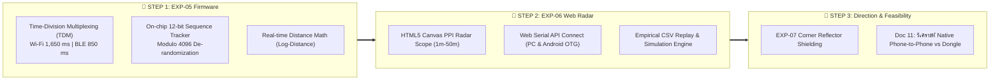

# 📋 รายงานสรุปแผนการดำเนินงานและการส่งมอบระบบ (Phase Implementation & Walkthrough Log)
## Tactical Dragon Radar: EXP-05, EXP-06, EXP-07 & Phone-to-Phone Feasibility

> 📅 **วันที่บันทึก:** 29 ตุลาคม 2026  
> 👥 **ทีมวิจัย:** โย (Yo) & นาย (Nine)  
> 🛰️ **ฮาร์ดแวร์:** Arduino Nano ESP32 / ESP32-S3  
> 📌 **สถานะ:** เสร็จสมบูรณ์พร้อมทดสอบและนำเสนอ (Completed & Verified)

---

## 🧭 1. แผนการดำเนินงาน 3 ขั้นตอนอย่างเป็นระบบ (Implementation Plan)

---

## 💻 2. รายละเอียดผลงานที่พัฒนาและคำสั่งใช้งาน (Artifacts & Usage Instructions)

### 🥇 Step 1: เฟิร์มแวร์รวมร่าง Wi-Fi + BLE TDM (EXP-05)
* **ไฟล์โค้ด:**
  * โค้ดหลัก: [`experiments/firmware/exp05_dual_radio_fusion/exp05_dual_radio_fusion.ino`](file:///d:/ProjectCo-op/experiments/firmware/exp05_dual_radio_fusion/exp05_dual_radio_fusion.ino)
  * สำเนาใน Vault: [`share_friend/Experiments/yo_experiments/Firmware/exp05_dual_radio_fusion/exp05_dual_radio_fusion.ino`](file:///d:/ProjectCo-op/share_friend/Experiments/yo_experiments/Firmware/exp05_dual_radio_fusion/exp05_dual_radio_fusion.ino)
  * คู่มือ: [`share_friend/Experiments/yo_experiments/Firmware/exp05_dual_radio_fusion/README.md`](file:///d:/ProjectCo-op/share_friend/Experiments/yo_experiments/Firmware/exp05_dual_radio_fusion/README.md)
* **การทำงานระดับชิป:**
  * **TDM Window:** สลับฟัง Wi-Fi Promiscuous กวาด 11 ช่อง (ช่องละ 150 ms) รวม 1,650 ms และ BLE GAP Scan ช่อง 37, 38, 39 อีก 850 ms
  * **Sequence De-randomization:** ฟังก์ชัน `isSequenceContinuous(oldSeq, newSeq, 20)` ตรวจจับเลขแพ็กเก็ต 12 บิตต่อเนื่องกัน แม้ MAC Address จะถูกสุ่มเปลี่ยน ก็สามารถรวบเป็น `Target_ID` เดียวกัน (เช่น `TGT-01`)
  * **On-chip Distance:** ฝังสมการ Log-Distance:
    $$d = 10^{\frac{-38.2 - \text{RSSI}_{\text{smooth}}}{24.5}}$$
* **คำสั่งเปิด Serial Monitor ดูข้อมูลดิบ:**
  * Baud Rate: `115200`
  * หัวตารางมาตรฐาน:
    `CSV_FUSION,timestamp_ms,target_id,radio_type,channel,rssi_raw,rssi_smooth,est_dist_m,delta_t_ms,seq_num,mac,mac_type,category,brand,extra_info`

---

### 🥈 Step 2: หน้าจอเรดาร์ยุทธวิธีสด (EXP-06: Tactical PPI Web Serial Dashboard)
* **ไฟล์หน้าจอเว็บ:**
  * โค้ดหลัก: [`experiments/dashboard/tactical_radar_dashboard.html`](file:///d:/ProjectCo-op/experiments/dashboard/tactical_radar_dashboard.html)
  * สำเนาใน Vault: [`share_friend/Experiments/yo_experiments/Dashboard/tactical_radar_dashboard.html`](file:///d:/ProjectCo-op/share_friend/Experiments/yo_experiments/Dashboard/tactical_radar_dashboard.html)
* **วิธีเปิดใช้งานและคำสั่งสาธิต:**
  1. ดับเบิลคลิกเปิดไฟล์ `tactical_radar_dashboard.html` ด้วย Google Chrome หรือ Microsoft Edge
  2. **กรณีต่อบอร์ดจริง:** เสียบสาย USB เข้าบอร์ด ESP32 แล้วกดปุ่ม `🔌 Connect ESP32 (Web Serial)` เลือกพอร์ต COM แล้วกดเชื่อมต่อ (รองรับทั้งคอมพิวเตอร์และมือถือ Android เสียบสาย Type-C OTG)
  3. **กรณีสาธิตอาจารย์โดยไม่เสียบบอร์ด (Demo Simulation):**
     * กดปุ่ม `▶️ Demo Replay (Empirical)`: เรดาร์จะจำลองคนหลงป่าเดินเข้าหาเรดาร์จากระยะ 25 เมตร มาถึง 4 เมตร พร้อมจำลองการสุ่มเปลี่ยน MAC และยิง BLE MTA Alliance
     * หรือกดปุ่ม `📂 Load CSV Log` เพื่อเลือกไฟล์ผลการทดลองจริง เช่น `exp04_omni_wifi_results.csv` หรือ `exp03_ble_results.csv` มาเล่นซ้ำสดๆ บนหน้าจอ

---

### 🥉 Step 3: บทวิเคราะห์วิศวกรรมการค้นหาระหว่างสมาร์ตโฟน (Doc 11)
* **เอกสารวิจัยฉบับเต็ม:**
  * ฉบับหลัก: [`docs/11_phone_to_phone_and_smart_dongle_feasibility.md`](file:///d:/ProjectCo-op/docs/11_phone_to_phone_and_smart_dongle_feasibility.md)
  * สำเนาใน Vault: [`share_friend/Research/yo_research/11_Phone_to_Phone_and_Smart_Dongle_Feasibility.md`](file:///d:/ProjectCo-op/share_friend/Research/yo_research/11_Phone_to_Phone_and_Smart_Dongle_Feasibility.md)
* **ข้อสรุปเชิงวิศวกรรม (Engineering Summary):**
  1. **ข้อจำกัดของ OS:** Android/iOS ทั่วไปถูกจำกัดโดย Kernel Sandbox ปิดกั้น Monitor Mode และมี Scan Throttling (สแกนได้แค่ 4 ครั้งต่อ 2 นาที) จึงไม่สามารถเขียนแอปบนมือถือเปล่าๆ เพื่อดักฟัง Wi-Fi Probe Request ได้
  2. **ช่องทาง Native ที่ทำได้จริงบนมือถือ:** การใช้ **BLE Low Latency Scanner API** ตรวจจับ Quick Share / MTA Alliance ได้สด 5–10 แพ็กเก็ต/วินาที และการใช้ **Wi-Fi Aware (NAN API)** บน Channel 6
  3. **สถาปัตยกรรมทางออกที่ดีที่สุด (FLIR One Model):** ใช้แนวคิด **Smartphone + USB-C Smart RF Dongle** บอร์ด ESP32-S3 จิ๋วเสียบใต้ตูดมือถือคนค้นหาผ่านสาย Type-C สั้นๆ ได้ทั้งความสามารถดักฟังวิทยุระดับลึก และได้ความสะดวกในการพกพามือถือเครื่องเดียวเดินป่า
  4. **EXP-07 Direction Finding:** การติดตั้งแผ่นสะท้อนคลื่น 90° Corner Reflector เพื่อสร้าง Front-to-Back Ratio 10–15 dB ชี้ทิศทางเดินเข้าหาผู้ประสบภัย

---

## 📊 3. ตารางสรุปการซิงก์ข้อมูลและสถานะไฟล์ (Files & Vault Sync Matrix)

| ส่วนประกอบ / ผลงาน | ไฟล์ในโปรเจกต์หลัก (`docs/` / `experiments/`) | ไฟล์ใน Vault ส่วนตัว (`share_friend/`) | สถานะ |
| :--- | :--- | :--- | :---: |
| **EXP-05 เฟิร์มแวร์รวมร่าง** | `experiments/firmware/exp05_dual_radio_fusion.ino` | `share_friend/Experiments/.../exp05_dual_radio_fusion.ino` | ✅ ซิงก์สมบูรณ์ |
| **EXP-06 หน้าจอเรดาร์สด** | `experiments/dashboard/tactical_radar_dashboard.html` | `share_friend/Experiments/.../tactical_radar_dashboard.html` | ✅ ซิงก์สมบูรณ์ |
| **Doc 10 คัมภีร์วิศวกรรม RF** | `docs/10_rf_sensing_parameters_and_hidden_systems.md` | `share_friend/Research/yo_research/10_RF_Parameters...md` | ✅ ซิงก์สมบูรณ์ |
| **Doc 11 วิเคราะห์ Phone-to-Phone** | `docs/11_phone_to_phone_and_smart_dongle_feasibility.md` | `share_friend/Research/yo_research/11_Phone_to_Phone...md` | ✅ ซิงก์สมบูรณ์ |
| **ศูนย์รวมข้อมูลโครงการ** | - | [`share_friend/00_DASHBOARD.md`](file:///d:/ProjectCo-op/share_friend/00_DASHBOARD.md) | ✅ ปักหมุดครบ |
| **บันทึกประวัติโครงการ** | [`process_and_workflow/conversation_history.md`](file:///d:/ProjectCo-op/process_and_workflow/conversation_history.md) | [`share_friend/Research/yo_research/yo_research_log.md`](file:///d:/ProjectCo-op/share_friend/Research/yo_research/yo_research_log.md) | ✅ บันทึกครบถ้วน |
