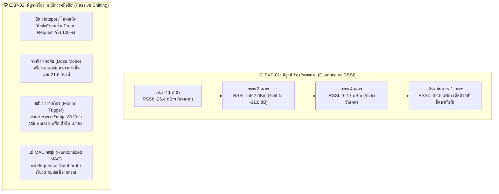

# 🔬 สรุปผลการทดลองวิจัยภาคสนาม: EXP-01 & EXP-02
## ระบบตรวจจับคลื่นสมาร์ตโฟนด้วย ESP32-Nano (Smartphone RF Sensing Testbed)

<div align="center">


</div>

> 📢 **สำหรับเพื่อนร่วมทีมและผู้สนใจ:**  
> หน้านี้คือ **"สรุปภาพรวมผลการทดลองจริง 2 ชุดแรก (Landing Page)"** เพื่อพิสูจน์ความเป็นไปได้ในการใช้บอร์ดขนาดเล็กอย่าง **ESP32-Nano** ในการดักจับคลื่นสมาร์ตโฟนเพื่อสร้าง **"เสาตรวจจับเฝ้าระวังผู้ประสบภัย (Checkpoint Geofence)"** ในพื้นที่ไร้สัญญาณ

---

## 🧭 แผนผังนำทางด่วน (Quick Navigation & File Links)

| การทดลอง | วัตถุประสงค์หลัก | โค้ดเฟิร์มแวร์ (Firmware) | ข้อมูลดิบ (Raw CSV) | รายงานฉบับเต็ม (Full Report) |
| :---: | :--- | :---: | :---: | :---: |
| **EXP-01** | **Active Scan & Distance vs RSSI**<br>วัดระดับความแรงสัญญาณเทียบกับระยะห่างจริง (1m, 2m, 4m) | [💻 โค้ด EXP-01](firmware/exp01_wifi_scanner/exp01_wifi_scanner.ino) | [📊 ข้อมูลดิบ EXP-01](raw_logs/2026-10-19_exp01_wifi_nano_distance_test.csv) | [📑 รายงาน EXP-01](reports/exp01_wifi_nano_profiling.md) |
| **EXP-02** | **Passive Wi-Fi Sniffing & Doze/Motion**<br>ดักฟัง Probe Request ตอนปิดเน็ต + ทดสอบจอดับ vs เขย่าเครื่อง | [💻 โค้ด EXP-02](firmware/exp02_passive_sniffer/exp02_passive_sniffer.ino) | [📊 ข้อมูลดิบ EXP-02](raw_logs/2026-10-19_exp02_passive_sniffer_results.csv) | [📑 รายงาน EXP-02](reports/exp02_passive_sniffer_profiling.md) |

---

## 💡 สรุปเนื้อหาสำคัญฉบับเข้าใจง่ายใน 3 นาที (Executive Summary)



---

## 🔍 เจาะลึกผลการทดลองทั้ง 2 ชุด

### 1️⃣ การทดลองที่ 1 (EXP-01): สัญญาณกับระยะห่างทางกายภาพ
* **โจทย์:** ค่าความแรงสัญญาณ (RSSI) ที่ ESP32-Nano วัดได้ สามารถบอกระยะห่างของคนได้จริงไหม?
* **ผลลัพธ์จากการทดสอบจริง:**
  * ที่ระยะประชิด `< 1 เมตร`: สัญญาณแรงมากเฉลี่ย **`-26.4 dBm`**
  * เมื่อถอยห่างออกไปที่ `2 เมตร`: สัญญาณตกลงอย่างรวดเร็วมาอยู่ที่ **`-58.2 dBm`** (ลดลงถึง 31.8 dBm)
  * เมื่อถอยห่างไปที่ `4 เมตร`: สัญญาณลดลงเหลือ **`-62.7 dBm`**
  * เมื่อเดินกลับเข้ามาที่ `< 1 เมตร`: สัญญาณกระโดดกลับขึ้นมาทันทีที่ **`-32.5 dBm`**
* **ข้อสรุป:** ความแรงสัญญาณลดทอนตามแบบจำลองคณิตศาสตร์ **Log-Distance Path Loss Model** อย่างแม่นยำ สามารถนำไปใช้คำนวณระยะทางได้จริง

---

### 2️⃣ การทดลองที่ 2 (EXP-02): การดักฟังคลื่นเร่ร่อนแบบพาสซีฟ (Zero-App)
* **โจทย์:** ถ้าคนหลงป่าไม่ได้เปิด Hotspot และไม่มีอินเทอร์เน็ต เรายังจะตรวจจับเขาได้ไหม?
* **ผลลัพธ์จากการทดสอบจริง (แจ็กพอต 4 ด้าน):**
  1. **ดักจับได้จริง 100% แม้ปิดเน็ต:** โทรศัพท์ยังคงยิงเฟรม **Probe Request** ออกสู่อากาศเพื่อถามหา AP
  2. **ความลับของ Doze Mode:** ตอนวางโทรศัพท์นิ่งๆ โทรศัพท์จะหน่วงเวลาส่งนานถึง **21.6 วินาที** เพื่อประหยัดแบตเตอรี่
  3. **การเคลื่อนไหวปลุกระบบ (Motion Wake-up):** ทันทีที่หยิบเครื่องขึ้นมา **"เขย่าหรือเดิน"** เซนเซอร์ Accelerometer ภายในโทรศัพท์จะปลุกชิป Wi-Fi ให้สาดแพ็กเก็ตออกมาเป็นชุดใหญ่ (**Burst รวดเดียว 8 แพ็กเก็ต ภายใน 0.48 วินาที**)
  4. **ทลายกำแพง MAC Randomization:** แม้ระบบปฏิบัติการจะสุ่มเปลี่ยนรหัส MAC Address หน้าตาใหม่ตลอดเวลา แต่ตัวนับภายในชิปฮาร์ดแวร์ (**Sequence Number**) จะนับเรียงลำดับต่อเนื่องกันเสมอ เช่น `1906, 1907, 1909, 1914...` ทำให้เราตามรอยได้ว่าเป็นคนเดิมแน่นอน!

---

## 🛡️ การนำไปสร้าง "เสา Checkpoint เฝ้าระวังโซน" ในชีวิตจริง

จากการทดลองจริง ระดับความแรงสัญญาณแบ่งชั้นออกเป็น 3 โซนตามธรรมชาติอย่างชัดเจน:
* 🟢 **ผู้ประสบภัยก้าวเข้ามาในวง Checkpoint (ระยะ < 5 เมตร):** `RSSI = -18 ถึง -58 dBm`
* 🟡 **คนอยู่ในระยะห่างปานกลาง (ห้องข้างเคียง):** `RSSI = -65 ถึง -75 dBm`
* 🔴 **สัญญาณรบกวนภายนอก / คนอยู่ไกลลิบ:** `RSSI = -93 ถึง -98 dBm`

```cpp
// ลอจิกสำหรับตั้งเสา Checkpoint เตือนภัยกู้ภัย
if (packet.rssi >= -60) {
    // ตรวจพบผู้ประสบภัยก้าวเข้าสู่วง Checkpoint รัศมี 10-15 เมตรแล้ว!
    triggerLoRaEmergencyAlert(); // ส่งสัญญาณ LoRa ข้ามป่า 5-10 กม. กลับฐาน
}
```

---

## 📂 โครงสร้างโฟลเดอร์ในส่วน `experiments/`

```text
experiments/
├── 📖 README.md                               <-- [คุณอยู่ที่นี่] หน้าสารบัญและสรุปภาพรวมทั้งหมด
│
├── 💻 firmware/                               <-- ซอร์สโค้ด Arduino สำหรับอัปโหลดลง ESP32
│   ├── exp01_wifi_scanner/exp01_wifi_scanner.ino
│   └── exp02_passive_sniffer/exp02_passive_sniffer.ino
│
├── 📊 raw_logs/                               <-- บันทึกข้อมูลดิบจาก Serial Monitor (.csv)
│   ├── 2026-10-19_exp01_wifi_nano_distance_test.csv
│   └── 2026-10-19_exp02_passive_sniffer_results.csv
│
└── 📑 reports/                                <-- เอกสารรายงานผลการทดลองเชิงวิชาการฉบับเต็ม
    ├── exp01_wifi_nano_profiling.md
    └── exp02_passive_sniffer_profiling.md
```

