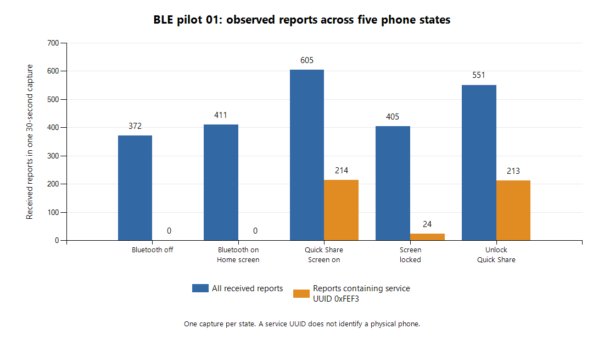

# BLE Pilot 01 — พฤติกรรมสัญญาณจากการทดลอง Honor X7b 5G

วันที่จัดชุดข้อมูล: **17 พฤศจิกายน 2026**  
สถานะ: **ผลนำร่อง 5 เงื่อนไข ครบเงื่อนไขละหนึ่งรอบ 30 วินาที**

## ผลสำคัญ

ในชุดนี้ รายงานที่มี Service UUID `0xFEF3` ไม่พบในรอบปิด Bluetooth และรอบเปิด Bluetooth หน้าโฮม พบ 214 รายงานเมื่อเปิด Quick Share, 24 รายงานในรอบล็อกจอ และ 213 รายงานเมื่อปลดล็อกกลับ Quick Share

นี่เป็น **ความสัมพันธ์ระหว่างสถานะที่ผู้ทดลองแจ้งกับสิ่งที่ตัวรับเห็น** ยังไม่ใช่การยืนยันตัวตน Honor จาก MAC หรือรหัสบริการ และยังใช้สรุปแทนโทรศัพท์รุ่นอื่นไม่ได้

## 1. อุปกรณ์และวิธีเก็บ

| รายการ | ข้อมูลและที่มา |
| :--- | :--- |
| โทรศัพท์ที่จัดสถานะทดลอง | Honor X7b 5G ตามที่ผู้ทดลองยืนยัน |
| Android / MagicOS | ยังไม่ได้ระบุเวอร์ชัน จัดเก็บเป็น `UNKNOWN` |
| ตัวรับ | Arduino Nano ESP32 / ESP32-S3; ล็อก BOOT ระบุ `chip=ESP32-S3` |
| SDK ใน BOOT ที่มีข้อมูล | `v4.4.7-dirty` |
| เฟิร์มแวร์ | BLE Behavior Logger รุ่นที่แสดง `AD_DETAILS`; สำเนาซอร์ส ณ เวลาจัดชุดอยู่ใน `firmware_snapshot/` ไม่ใช่ firmware ที่อ่านกลับจากบอร์ด |
| โหมดรับ | Passive Scan |
| Scan interval / window | 100 / 80 ms ตาม `SCAN_CONFIG` |
| Duplicate filtering | disabled ตาม `SCAN_CONFIG` |
| ระยะเวลา | ตั้งไว้ 30 วินาที; เวลาบนบอร์ดจาก `SCAN_STARTED` ถึง `TRIAL_END` = 30.001 วินาทีทุกไฟล์ที่เลือก |
| ช่องทางเก็บ | Arduino Serial Monitor → ข้อความต้นฉบับที่ผู้ทดลองส่ง |
| สถานะโทรศัพท์ | ผู้ทดลองเปลี่ยนเองและแจ้งลำดับ; คำสั่งบนบอร์ดเป็นป้ายรอบ ไม่ได้ตรวจหรือควบคุม OS มือถือ |
| ระยะ/ความสูง/ทิศวาง | มีคำแนะนำให้คงตำแหน่ง แต่ไม่ได้บันทึกค่าที่วัดจริงในไฟล์ชุดนี้ จึงไม่อ้างระยะเป็นเมตร |

ไม่มีข้อมูลระบุ channel ของ BLE ต่อรายงาน จึงไม่สร้างค่า channel ขึ้นเอง และไม่ใช้เวลาระหว่างรายงานแทนคาบส่งจริงของมือถือโดยอัตโนมัติ

## 2. ผลทั้ง 5 เงื่อนไข

ตารางเรียงตามเงื่อนไขเพื่อให้อ่านง่าย **ไม่ใช่ลำดับเวลาจริง**: OFF ล่าสุดเก็บภายหลังเพื่อแทนไฟล์ OFF ที่ขาดท้าย รอบอื่นเก็บตามเวลาในตาราง

| รหัสชุดย่อย | สถานะที่แจ้ง | เวลาบน Serial Monitor | รายงานทั้งหมด | รายงานที่มี `0xFEF3` | RSSI เฉลี่ยของกลุ่มนี้ (dBm) |
| :--- | :--- | :--- | ---: | ---: | ---: |
| `p01_01_bt_off` | ปิด Bluetooth — ใช้ไฟล์ทดแทน | 11:52:11–11:52:41 | 372 | 0 | ไม่มีข้อมูล |
| `p01_02_bt_on_home` | เปิด Bluetooth หน้าโฮม | 11:44:45–11:45:15 | 411 | 0 | ไม่มีข้อมูล |
| `p01_03_quick_share` | เปิดหน้า Quick Share พร้อมรับ | 11:46:03–11:46:33 | 605 | 214 | -52.44 |
| `p01_04_screen_locked` | ล็อกจอ โดยคงการตั้งค่าเดิม | 11:47:22–11:47:52 | 405 | 24 | -67.38 |
| `p01_05_unlocked_share` | ปลดล็อกกลับหน้า Quick Share | 11:48:44–11:49:14 | 551 | 213 | -53.47 |
| **รวม** | **5 รอบที่จบครบ** | | **2,344** | **451** | ไม่รวมข้ามสถานะ |

หน่วยคือ **รายงานที่ BLE stack ส่งให้โปรแกรมรับ** ไม่ใช่จำนวนอุปกรณ์ ไม่ใช่จำนวนแพ็กเก็ตที่โทรศัพท์ส่งทั้งหมด และไม่ใช่จำนวนรายงานจาก Honor ที่ยืนยันตัวตนแล้ว

แท่งสีน้ำเงินแสดงรายงานทุกกลุ่ม แท่งสีส้มแสดงเฉพาะรายงานที่มี Service UUID `0xFEF3` ซึ่งถอดจาก AD field ของ Advertising หรือ Scan Response ไม่ใช้เพียงการค้นหาข้อความ hex ที่อาจบังเอิญอยู่ใน Manufacturer Data

## 3. แยกกลุ่มสัญญาณที่ตามอยู่

| เงื่อนไข | MAC ที่พบกลุ่ม `0xFEF3` | จำนวน | RSSI ต่ำสุด–สูงสุด (dBm) | ลักษณะต้น payload ที่สังเกต |
| :--- | :--- | ---: | :--- | :--- |
| Quick Share เปิดจอ | `2A:63:59:3C:A1:CE` | 214 | -80 ถึง -47 | `0201021A16F3FE...` |
| ล็อกจอ | `29:24:29:F3:62:10` | 24 | -80 ถึง -64 | `1E16F3FE4A17...` |
| ปลดล็อกกลับ | `21:41:51:5D:6A:9F` | 213 | -81 ถึง -48 | `0201021A16F3FE...` |

MAC และรูปแบบ payload ต่างกันระหว่างสถานะ จึง **ไม่เชื่อมสาม MAC เป็นโทรศัพท์เครื่องเดียวกันโดยอัตโนมัติ** และไม่เรียก 24 รายงานในรอบล็อกจอว่า “Honor ยังส่ง 24 ครั้ง” การระบุด้วย Service UUID อย่างเดียวอาจรวมอุปกรณ์อื่นที่ใช้บริการตระกูลเดียวกัน

รูปแบบจำนวน 214 → 24 → 213 และข้อมูลที่เปลี่ยนไปเป็นหลักฐานสำหรับตั้งสมมติฐานเรื่องผลของสถานะหน้าจอ/ฟีเจอร์ในสภาพทดลองนี้ แต่ยังแยกสาเหตุจากการเปลี่ยนแหล่งสัญญาณหรือปัจจัยรอบข้างไม่ได้ทั้งหมด ไม่ได้ทดสอบนัยสำคัญทางสถิติ

การไม่พบกลุ่มนี้ในหน้าโฮมหรือรอบ OFF หมายถึง **ไม่พบรายงานบริการนี้ในช่วงที่เก็บ** ไม่ได้พิสูจน์ว่าโทรศัพท์ไม่มีการปล่อย Bluetooth ทุกชนิด

## 4. ค่าที่เพิ่มใน Arduino อ่านได้หรือไม่

ทั้งห้ารอบมีแถว `AD_DETAILS` รวม **43 แถว** และแถวเหล่านั้นแสดง `decode_warnings=0` ทุกแถว ข้อมูลดิบที่เลือกตรวจผ่านรูปแบบ 20 คอลัมน์และความยาว hex ตรงกับ `adv_len` / `scan_rsp_len` ทุก REPORT

- พบการถอด `service_uuids16=0xFEF3` และ `fef3_service=yes` ตรงกับกลุ่มบริการที่นับในรายงาน
- มี Manufacturer ID เช่น `0x0006` และ `0x004C` ในสัญญาณรอบตัว ไม่ใช้รหัสเหล่านี้ยืนยันว่าเป็น Honor หรือระบุรุ่นเครื่อง
- มี Flags และค่า TX power ที่ประกาศ เช่น 0, 11 และ 12 dBm ในบางแหล่ง ไม่ใช่กำลังส่งที่ตัวรับวัดเอง และไม่ใช่ค่าของ Honor ที่ยืนยันแล้ว
- ชื่อที่เห็นเป็น `not_advertised` คือไม่มีชื่อในข้อมูลที่รับ ไม่ใช่การอ่านชื่อไม่สำเร็จโดยอัตโนมัติ
- จำนวน `AD_DETAILS` ไม่ใช่จำนวน REPORT เพราะเฟิร์มแวร์ลดการแสดงรายละเอียดซ้ำด้วย cache รายงานดิบยังแยกเก็บตามเดิม

ผลนี้ยืนยันการใช้งานส่วนถอดค่ากับข้อมูลชุดนี้ ไม่ใช่ชุดทดสอบความถูกต้องครบทุกประเภท AD หรือทุกอุปกรณ์

## 5. คุณภาพและที่มาของข้อมูล

ตรวจนำเข้าครบแล้ว:

1. สำเนา Serial ต้นฉบับ 5 ไฟล์ที่ใช้ และ OFF เดิมที่ตัดออก 1 ไฟล์ มี SHA-256 ตรงกับไฟล์แนบต้นทาง
2. รอบที่เลือกมี `TRIAL_BEGIN`, `SCAN_STARTED`, `TRIAL_END` และสถานะ `DURATION_COMPLETE` ครบ
3. จำนวน REPORT ตรงกับ `received_reports` ตอนจบรอบ และ report ID ต่อเนื่องตั้งแต่ 1 ถึงจำนวนสุดท้ายภายในแต่ละไฟล์
4. REPORT ทั้งหมด 2,344 แถวผ่านรูปแบบและความยาว payload; การถอด AD ฝั่งสรุปไม่มี parse error
5. `dropped_reports=0` ในข้อมูลที่เลือก หมายถึงไม่มีรายงานตกที่คิวซึ่ง logger ตรวจนับได้ ไม่รับรองว่ารับคลื่นหรือ USB ครบทุกแพ็กเก็ต
6. แถว idle/BOOT/ข้อมูลสถานะจากรอบก่อนยังคงอยู่ในไฟล์ต้นฉบับ แต่ไม่รวมใน CSV ของช่วงทดลองที่เลือก
7. หลายไฟล์เริ่มบอร์ดใหม่และใช้ `trial1` ซ้ำ จึงเพิ่ม `capture_id` เฉพาะแต่ละไฟล์ โดยคง `session_id`/`trial_id` เดิมไว้ ไม่รวมข้ามรอบตามเลข trial อย่างเดียว

OFF เดิมเก็บได้ถึงประมาณ **18.605 วินาทีหลังเริ่มสแกน** มี 260 REPORT และไม่มี `TRIAL_END` ในไฟล์ที่ส่ง จึงเก็บไว้ใน `excluded/` และไม่นำมารวมผล 5 รอบ การขาดท้ายไฟล์ไม่ใช่หลักฐานว่าตัวบอร์ดหยุดผิดพลาด

วันที่อ้างอิงมาจากวันที่สนทนา/จัดชุดข้อมูล เวลาหน้า Serial Monitor ไม่มีวันที่หรือ timezone อยู่ในแถวข้อมูล ไม่อ้างว่าเป็น timestamp ที่โทรศัพท์ส่งจริง

## 6. ข้อจำกัดและงานถัดไป

ชุดนี้ใช้เป็นผลนำร่องและตรวจว่าขั้นตอนเก็บหลายค่าทำงานได้ ยังไม่ใช่ผลประเมินระบบค้นหาโทรศัพท์สำเร็จรูป:

- มีหนึ่งรอบต่อเงื่อนไขในชุดนี้ ยังไม่ใช้วัดความเชื่อมั่นทางสถิติหรือประสิทธิภาพการค้นพบ
- ไม่ได้สุ่มลำดับ และ OFF ที่ใช้แทนเก็บภายหลัง จึงอาจมีผลของประวัติการเปิดฟีเจอร์ เวลา และสภาพแวดล้อม
- สถานะมือถืออ้างอิงจากผู้ทดลอง ไม่ได้อ่านกลับจาก OS; ยังขาด Android/MagicOS เวอร์ชันจริง ระยะวัด และเวลารอหลังเปลี่ยนสถานะ
- สัญญาณพื้นหลังมีหลายกลุ่ม ไม่มี ground truth ที่ยืนยันเจ้าของทุก MAC จึงยังวัด false positive/false negative หรือจับคู่ MAC ข้ามสถานะไม่ได้
- RSSI ใช้บรรยายสิ่งที่ตัวรับเห็น ไม่แปลงเป็นระยะทางหรือพิสูจน์ความแม่นยำระดับเมตร
- ยังไม่ได้ทดสอบช่วงล็อกจอ/พักเครื่องนานหลายนาทีจนเข้าโหมดประหยัดพลังงาน ไม่ใช้รอบ 30 วินาทีแทนการทดสอบ Doze

ก่อนขยายไปหูฟังหรือนาฬิกา ให้เติมข้อมูล OS/ตำแหน่งจริงและทำชุดควบคุมซ้ำในสภาพเดิม โดยเน้นยืนยันแหล่งสัญญาณจากเครื่องเป้าหมาย การทดลองถัดไปควรทำด้วยเหตุผลนี้ ไม่เก็บคู่เดิมเพิ่มโดยไม่มีคำถามที่ต้องตอบ

## 7. เปิดดูไฟล์และตรวจซ้ำ

- [โฟลเดอร์ชุดข้อมูลและคำอธิบาย](../raw_logs/2026-11-17_ble_pilot_01/README.md)
- [ตารางสรุปต่อรอบ](../raw_logs/2026-11-17_ble_pilot_01/summary.csv)
- [ตารางแยก MAC และค่าที่ถอดได้](../raw_logs/2026-11-17_ble_pilot_01/addresses.csv)
- [REPORT รวมพร้อมรหัสรอบ เวลาในรอบ และบรรทัดต้นทาง](../raw_logs/2026-11-17_ble_pilot_01/all_reports.csv)
- [เวลาเริ่ม–จบและ hash ของแต่ละต้นฉบับ](../raw_logs/2026-11-17_ble_pilot_01/capture_index.csv)
- [รายละเอียดที่มาและรายการตัดออก](../raw_logs/2026-11-17_ble_pilot_01/provenance.json)
- [ผลตรวจคุณภาพ](../raw_logs/2026-11-17_ble_pilot_01/quality_checks.json)

สร้างตารางสรุปจากข้อมูลที่จัดไว้ใหม่ได้ด้วย `experiments/tools/summarize_ble_session.ps1` และกราฟด้วย `experiments/tools/plot_ble_pilot.ps1` เครื่องมือเหล่านี้เป็นการประมวลผลไฟล์ที่เก็บแล้ว ไม่ควบคุมโทรศัพท์หรือเริ่มการทดลองบนบอร์ด
