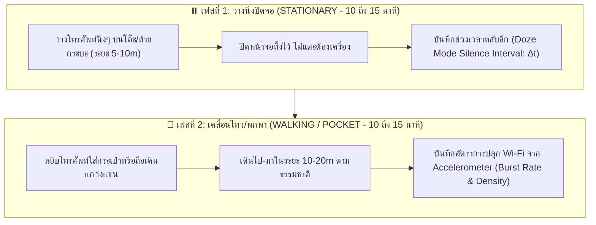

# 🧪 รายงานผลการทดลองวิจัย: การทำแผนที่แกนเวลาและการเคลื่อนไหว (DATASET-B)
## (Temporal & Motion Dynamics Profiling: Deep Doze vs Motion-Triggered Activity)

* **รหัสชุดข้อมูล:** `DATASET-B-MOTION`
* **วันที่เริ่มเก็บข้อมูล:** 2026-10-20
* **ฮาร์ดแวร์ภาครับ (Receiver):** Arduino Nano ESP32 (ชิป ESP32-S3)
* **เฟิร์มแวร์ทดสอบ:** [`experiments/firmware/dataset_b_motion_sniffer/dataset_b_motion_sniffer.ino`](file:///d:/ProjectCo-op/experiments/firmware/dataset_b_motion_sniffer/dataset_b_motion_sniffer.ino)
* **ไฟล์บันทึกข้อมูลดิบ:** [`experiments/raw_logs/dataset_b_motion_test.csv`](file:///d:/ProjectCo-op/experiments/raw_logs/dataset_b_motion_test.csv)

---

## 1. วัตถุประสงค์และสมมติฐานทางวิทยาศาสตร์ (Objectives & Hypotheses)

ในภารกิจค้นหาและกู้ภัย (Search and Rescue - SAR) พฤติกรรมของสมาร์ตโฟนขึ้นอยู่กับ **สถานะทางกายภาพของผู้ประสบภัย** เป็นสำคัญ:

1. **กรณีคนหมดสติ / บาดเจ็บ หรือโทรศัพท์ตกหล่น (Stationary / Deep Doze State):**
   * ระบบปฏิบัติการ Android/iOS จะเข้าสู่โหมดประหยัดพลังงานขั้นลึก (Deep Sleep / Doze Mode)
   * **สมมติฐาน:** โทรศัพท์จะยืดระยะเวลาการส่ง Probe Request ให้นานขึ้นเรื่อยๆ (Exponential Backoff) เช่น จากทุกๆ 20 วินาที เป็น 60 วินาที หรือหลายนาที
2. **กรณีคนกำลังเดินหาทางออก (Active Walking / Motion State):**
   * เซนเซอร์ความเร่งภายในตัวเครื่อง (IMU / Accelerometer) จะตรวจจับการสั่นไหวและก้าวเดิน
   * **สมมติฐาน:** ฮาร์ดแวร์จะส่ง Hardware Interrupt ไปปลุกชิป Wi-Fi ให้สาดแพ็กเก็ตออกมาเป็นชุด (Packet Burst) บ่อยครั้งขึ้นอย่างมีนัยสำคัญ

---

## 2. ขั้นตอนและระเบียบวิธีทดสอบ (Experimental Protocol)

---

## 3. ตารางบันทึกผลการทดลองเปรียบเทียบ (Empirical Comparison Table)

*(กำลังรอข้อมูลจากการทดสอบจริง)*

| สถานะการทดสอบ (Motion State) | จำนวนแพ็กเก็ตทั้งหมด | จำนวนระลอก (Bursts) | ช่วงเวลาเงียบเฉลี่ย ($\Delta t_{\text{silence}}$) | ช่วงเวลาเงียบสูงสุด (Max Silence) | ความหนาแน่นแพ็กเก็ตต่อ Burst | การตอบสนองของเซนเซอร์ |
| :--- | :---: | :---: | :---: | :---: | :---: | :--- |
| **1. วางนิ่งปิดจอ (STATIONARY)** | รอผล | รอผล | รอผล | รอผล | รอผล | เข้าสู่ Doze Mode ยืดเวลานอน |
| **2. ถือเดินแกว่งแขน (WALKING)** | รอผล | รอผล | รอผล | รอผล | รอผล | เซนเซอร์ปลุกให้ยิงถี่ขึ้น |
| **3. ใส่กระเป๋ากางเกงเดิน (POCKET)** | รอผล | รอผล | รอผล | รอผล | รอผล | จำลองการพกพาจริงในชีวิตประจำวัน |

---

## 4. บทวิเคราะห์ทางวิศวกรรม (Engineering Insights)
*(จะได้รับการอัปเดตทันทีเมื่อได้รับข้อมูลดิบจาก Serial Monitor)*

